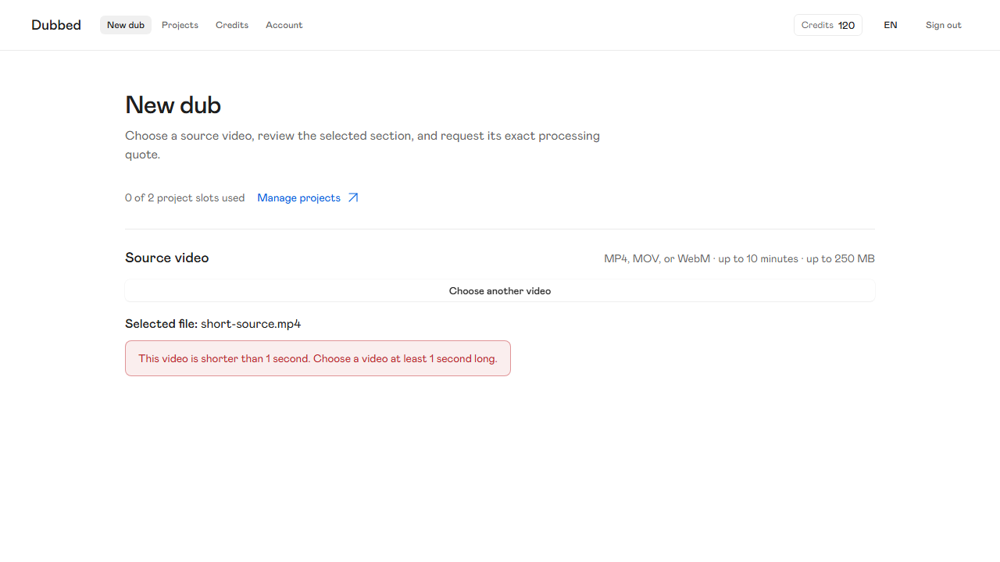
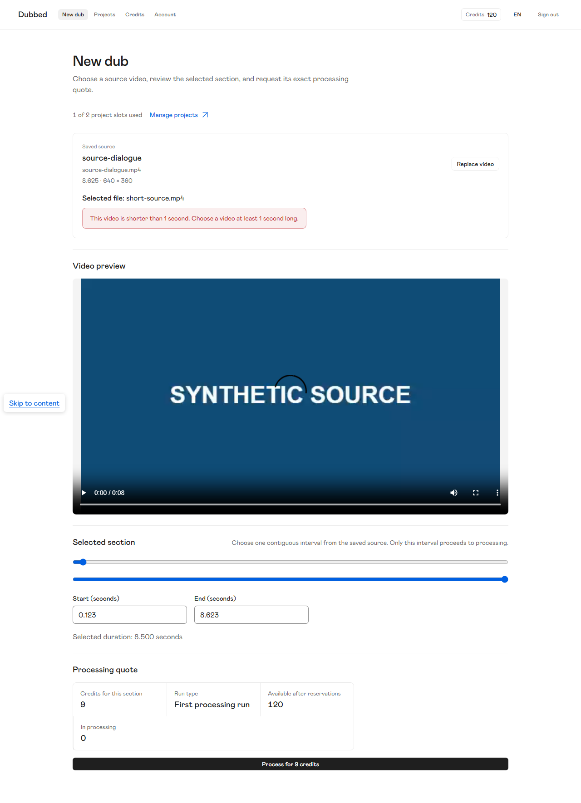

# Short-source upload boundary evidence

Date: 2026-10-25 (Asia/Qyzylorda)  
Checkout revision: `0c9b9d6069fcf625c1d54a2709ea16e8f0cbb2d2`  
Evidence scope: local frontend and mock service behavior only. The checkout had unrelated pre-existing documentation and skill edits; no commit or GitHub update was made for this slice.

## Decision implemented

The New Dub upload path rejects a validated video whose established duration is below 1,000 ms. A 1,000 ms source remains eligible. EN and RU errors tell the user to choose a video at least one second long.

The mock upload service enforces the same minimum at its public upload boundary. Selecting an invalid replacement keeps the current source, saved section, and quote until an eligible replacement commits. Successful replacement clears the old quote and reloads the default section for the new source.

## Checks

`npm.cmd --prefix frontend run test -- src/features/new-dub/NewDubScreen.test.tsx tests/services/project-title-and-replacement.test.ts` — PASS, 2 files and 7 tests. Component tests feed 999 ms and 1,000 ms probe facts and verify localized EN/RU rejection and 1,000 ms eligibility. The public mock-service test rejects a fresh 999 ms source without changing project/source/quote/preparation/reservation/ledger store counts, admits 1,000 ms and issues a 1-credit one-second quote, then rejects a 999 ms replacement while preserving the exact project, source bytes, quote, credit snapshot/history, store counts, and capacity.

`npm.cmd --prefix frontend run test:e2e -- new-dub-upload-boundary.spec.ts` — PASS, 1 Playwright test. The browser loads `short-source.mp4` with native metadata and container inspection, shows the actionable error, and leaves capacity at 0 of 2. After a valid source is saved and quoted, the same native short file is rejected as a replacement while the saved filename/title, source preview URL, selected interval, 9-credit quote, and capacity remain. A valid replacement then resets the interval and removes the old quote. The Playwright configuration runs Chromium with muted audio and fake media devices; this test requests no microphone.

`npm.cmd --prefix frontend run typecheck` — NOT PASS. `tsc -b --pretty false` reported TS6133 for `inspectLoserTabFences` at `frontend/e2e/full-journey.spec.ts:24` and `explicitlyReleaseOwnerGrant` at `frontend/e2e/full-journey.spec.ts:131`. Those diagnostics are outside this slice; that file was left untouched. No typecheck diagnostics were reported for the assigned files.

`git diff --check` — PASS for the in-scope code changes. Git emitted only its usual LF-to-CRLF working-copy notices.

## Media and visual evidence

The unchanged `frontend/public/media/short-source.mp4` fixture has SHA-256 `bf9a8d81981e16d58b7935e7e5deabe8769015b5e09ba8ffc25910c6510bde20`. Its existing `frontend/public/media/fixture-manifest.json` records native Chromium metadata of 0.646867 seconds, a playable MP4, and one decoded audio track. The E2E test does not override duration metadata. The manifest's `rejectionThresholdAssumed: false` remains historical fixture-generation provenance; it is not the current product decision.

The exact 999 ms versus 1,000 ms boundary is covered with service and component facts; the native browser fixture is 0.646867 seconds, not a 999 ms fixture. This evidence does not establish production backend, storage, billing, or service behavior.
