# Page evidence matrix

This matrix covers every primary page in the actual route registry, rather than treating 21 issue reviews as 21 pages. Route evidence: `frontend/src/app/routes.ts:7–21,60–101,138–220`; screen dispatch: `frontend/src/app/FeatureRoute.tsx:12–27,142–169`. There are **13 primary pages**, plus not-found, shared session/startup gates and route-specific states. Prepare, Sharing and Public viewer are withdrawn specs, not implemented pages in this registry. #61/#63/#64/#67/#68/#70/#72/#73 are contracts, gates or foundations, not additional standalone product pages; #76 is deferred real-adapter work.

Every image embedded below was opened with `view_image` by this auditor. Before images come from the frozen 2026-10-25 review at baseline `9d286621177200fdb5f61ef963d0b6818ae76774`; after images are correction-owner evidence from the shared dirty worktree, **not a new capture or acceptance by this auditor**. Fixtures, widths, states and accounts sometimes differ. Such pairs support composition comparisons, not pixel-diff or controlled before/after performance claims. State lists distinguish inventoried behavior from directly inspected stills. This audit did not repeat the wider checks recorded in the earlier reviews.

At audit time, original-task attribution used the full published body and archived source fingerprints rather than today's issue-link stub. Active specs may include correction-era changes; the line references and analysis below record the comparison made at that time.

| Page / route | Originating issue and task key | Flow | Direct visual sample in this audit | Disposition |
|---|---|---|---|---|
| Landing `/` | #78 responsive_shell_tokens_and_locale | 01 + shared | EN desktop before/after | Minimal contract followed; larger CTA improves salience, no claim that minimal landing must become marketing-heavy |
| Sign in `/sign-in` | #80 signin_sessions_and_protected_return | 02 | Empty before; provider-conflict after; session gate pair | Corrected recovery, still heavy form/error composition |
| Registration `/register` | #82 verified_registration_and_identity_collisions | 03 | Code step before/after | Heading repair helps; administrative counters/mock notice still distract |
| Reset `/reset-password` | #71 password_reset_and_session_recovery | 04 | RU phone code before/after | Duplicate instruction removed; request/code/password/completion must remain one comprehensible journey |
| Linking `/account-linking` | #66 explicit_login_method_linking | 05 | Final-review desktop before/after | Safer identity disclosure; repeated proof/review structure remains long |
| New dub `/new` | #81 validated_upload_selection_and_quote | 06 | Full-page before; 1440×700 after | Substantial composition improvement, timeline operability remains separate from fit |
| Processing `/projects/:id/processing` | #74 preparation_progress_cancel_and_reprocess | 07 | Running-known fixture before/after | More truthful accounting; progress now subordinate to detail |
| Microphone `/microphone?origin=new/project` | #69 microphone_check_and_device_readiness | 09 §4.1 | Ready desktop before/short after | Continue promoted; setup still reads as technical diagnostics |
| Record `/projects/:id/record` | #77 recording_capture_draft_acceptance | 09 §4.2 | Ready before/after, short fallback, 3 owner images | Main redesign priority; domain correctness and performance interaction need separate review |
| Result `/projects/:id/result` | #79 result_generation_playback_and_download | 10 | Ready before; descriptor-recovered after | Larger actions/recovery improve delivery; generation/version communication still needs realistic journey review |
| Projects `/projects` | #75 project_library_resume_and_deletion | 11 | Desktop long titles before; RU phone after | Overflow/targets addressed; title recognizability and repeated unavailable previews need refinement |
| Credits `/credits` | #65 credits_purchase_history_and_return | 12 | Verified before; pending/history after | Reconciliation fixes matter; simulator actions dominate product decision |
| Account `/account` | #62 account_settings_signout_and_deletion | 15 | Ready before; wrong-password after | Useful hierarchy/error repairs; technical explanatory prose remains |

## 1. Landing

Original #78 task (saved local body removed) · [Flow01](../../frontend-flows/01-landing.md) §4, especially lines 70–105 · review #78 (local report removed) QA-78-01–04 · [correction folder](../visual-qa-fixes-2026-10-25/issue-78/).

| Before: EN desktop | After: EN desktop |
|---|---|
| 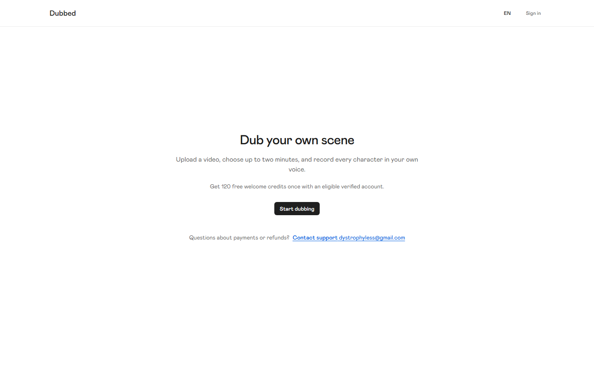 | 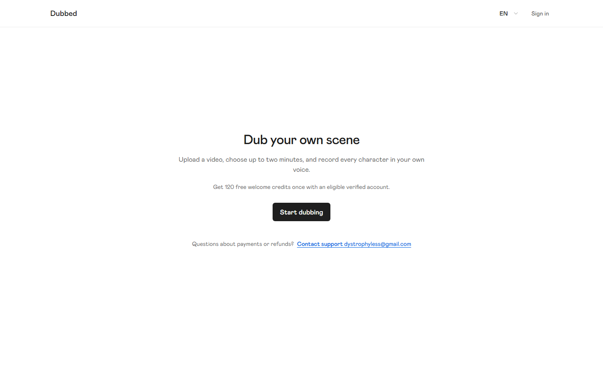 |

The minimal title, one proposition and one CTA are intentional. Whitespace alone is not a defect. The tiny original CTA was a poor action-to-canvas relationship; the after state corrects that without inventing marketing sections. The support/payment line remains visually detached below the primary content, but has a legitimate support role. The broader critique should not erase the owner's deliberate minimal landing.

Reviewer caught compact desktop actions, narrow phone close target, weak locale affordance and OTP mapping; the latter belongs to shared controls rather than Landing. Executor enlarged roles/locale affordance. No evidence here proves conversion improvement. Remaining journey check: Start dubbing should lead clearly into registration, and returning signed-in/deleted/signed-out states should not contradict identity. Those return states were not independently visually sampled in this audit.

## 2. Sign in and protected-session recovery

Original #80 task (saved local body removed) · [Flow02](../../frontend-flows/02-sign-in.md) §4, lines 68–104 · review #80 (local report removed) lines 43–93 · [receipt](../visual-qa-fixes-2026-10-25/issue-80/completion.md).

| Before: empty EN form | After: EN provider-conflict state |
|---|---|
| 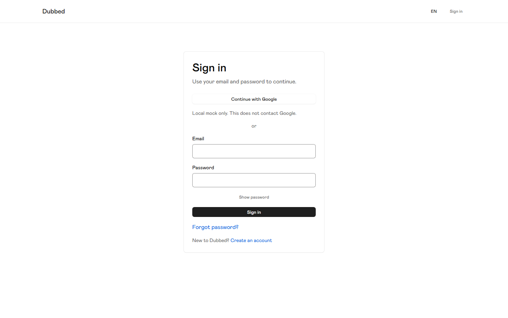 | 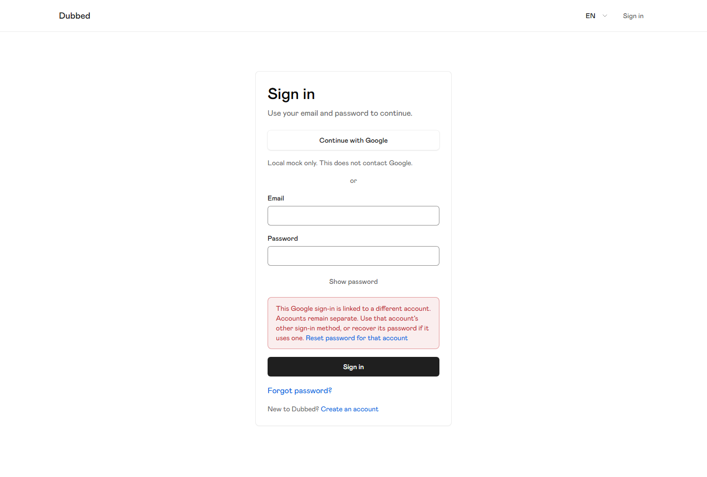 |

The basic narrow form and visible labels are suitable. The after error is more truthful than generic stale-information copy, but its four-line block plus recovery link expands an already tall form. The opening instruction mentions email/password while Google is the first action; mock explanation and a standalone Show password row add reading/vertical effort. These are composition opportunities, not a claim that Google/email alternatives are wrong.

Reviewer caught the expired-session Retry loop and misleading provider-conflict message. The session-gate pair below demonstrates an actual useful correction: the action now corresponds to recovery. Preserve it. Next review should test entry with a protected project intent, form failure with values preserved, provider conflict, successful return, and expiry while mid-task. The stills do not prove those transitions.

| Before: expired gate | After: expired gate |
|---|---|
| 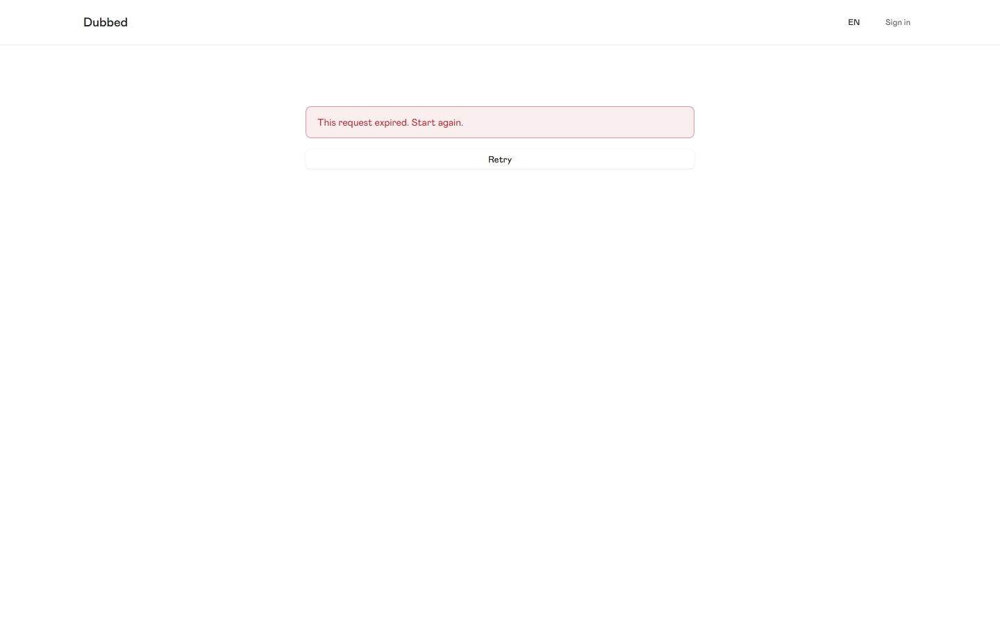 | 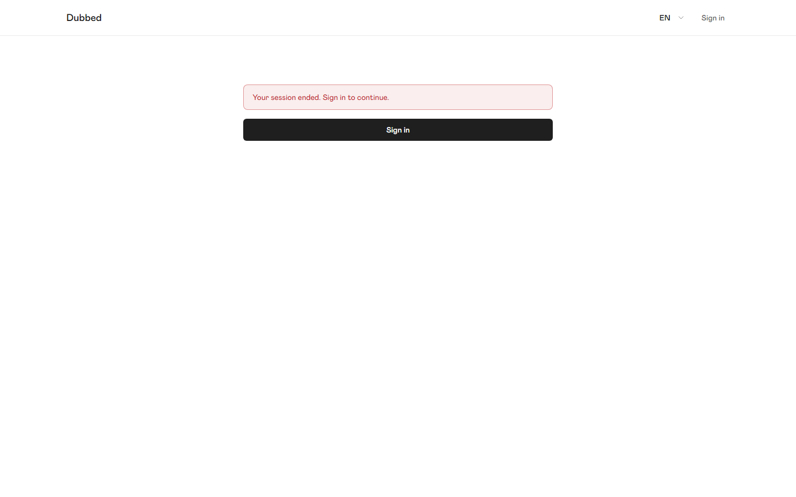 |

## 3. Registration and verification code

Original #82 task (saved local body removed) · [Flow03](../../frontend-flows/03-registration.md) §§4–5, lines 61–88 · review #82 (local report removed) lines 35–109 · [receipt](../visual-qa-fixes-2026-10-25/issue-82/completion.md).

| Before: code step, short desktop full-page | After: code step, short desktop |
|---|---|
| 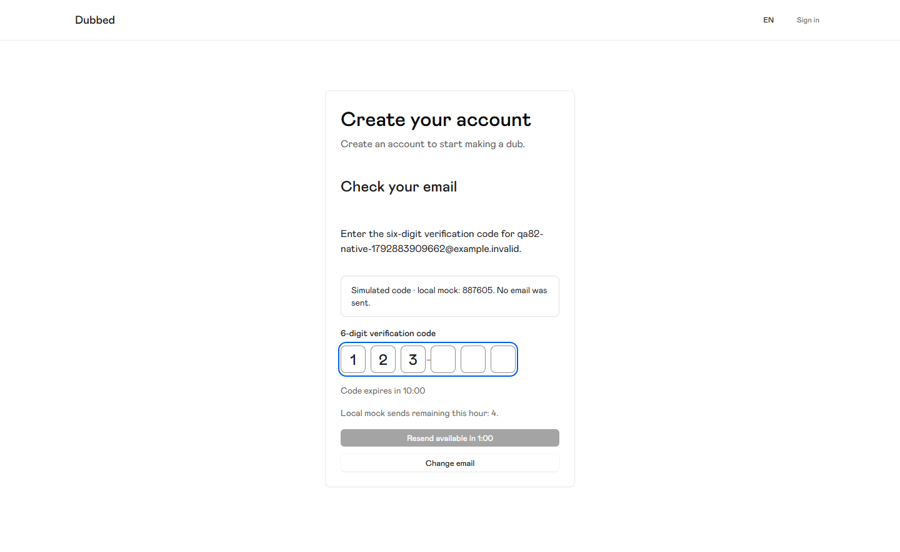 | 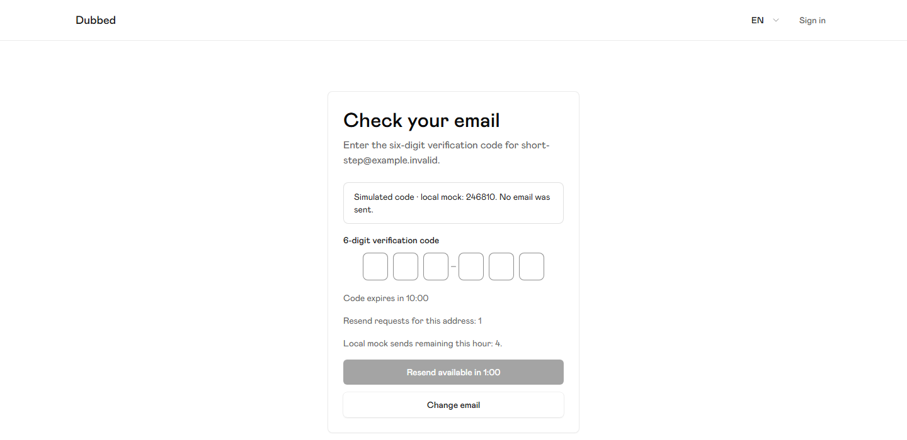 |

The after page names the current task instead of retaining a Create account heading above Check your email. That is meaningful state orientation. The original gap between headings and duplicated hierarchy was avoidable. The after still shows code expiry, resend-request count and mock hourly quota before the resend/change-email controls. Some timing feedback is useful; all counters need not remain equal-weight persistent content. Separate anti-abuse rules from what a person needs to act now.

Reviewer also caught long-email overflow, invisible OTP caret/selection and form replacement during loading. Corrections addressed those contracts; this audit inspected representative code-step composition, not every keyboard/invalid/loading state. Remaining must-see sequence: initial form → stable submitting → code → wrong code retained/editable → resend/change email → success/new workspace, with long RU address and keyboard. A six-cell appearance alone does not establish usable logical input.

## 4. Password reset

Original #71 task (saved local body removed) · [Flow04](../../frontend-flows/04-password-reset.md) §4, lines 59–96 · review #71 (local report removed) lines 37–75 · [receipt](../visual-qa-fixes-2026-10-25/issue-71/completion.md).

| Before: RU phone code | After: RU phone code |
|---|---|
| 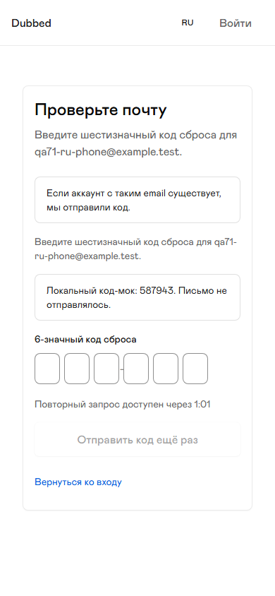 | 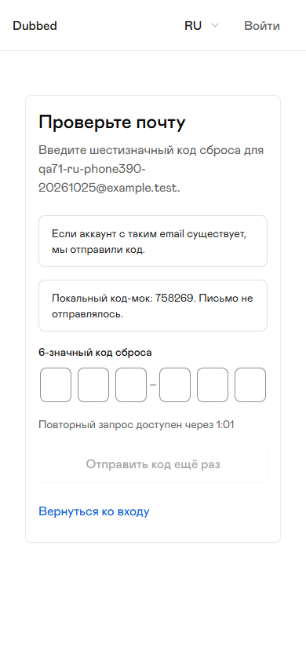 |

The duplicate code instruction is removed; this reduces load without weakening security. The neutral account-existence statement remains necessary. The local mock-code notice is useful for this prototype, but should belong to an explicit simulation presentation rather than the future production task hierarchy. Do not remove existence neutrality in the name of shorter copy.

Reviewer found missing password visibility controls and missing completion/session confirmation, not merely size defects. The correction receipt adds those. This pair does not independently verify password stage or destination notice. The remaining product review should follow request → code → password → successful safe destination, checking that the user knows the reset finished and does not accidentally repeat it after navigation/reload.

## 5. Account linking

Original #66 task (saved local body removed) · [Flow05](../../frontend-flows/05-account-linking.md) §5 · review #66 (local report removed) lines 49–129 · [receipt](../visual-qa-fixes-2026-10-25/issue-66/completion.md).

| Before: native final review, full-page | After: controlled final review, full-page |
|---|---|
| 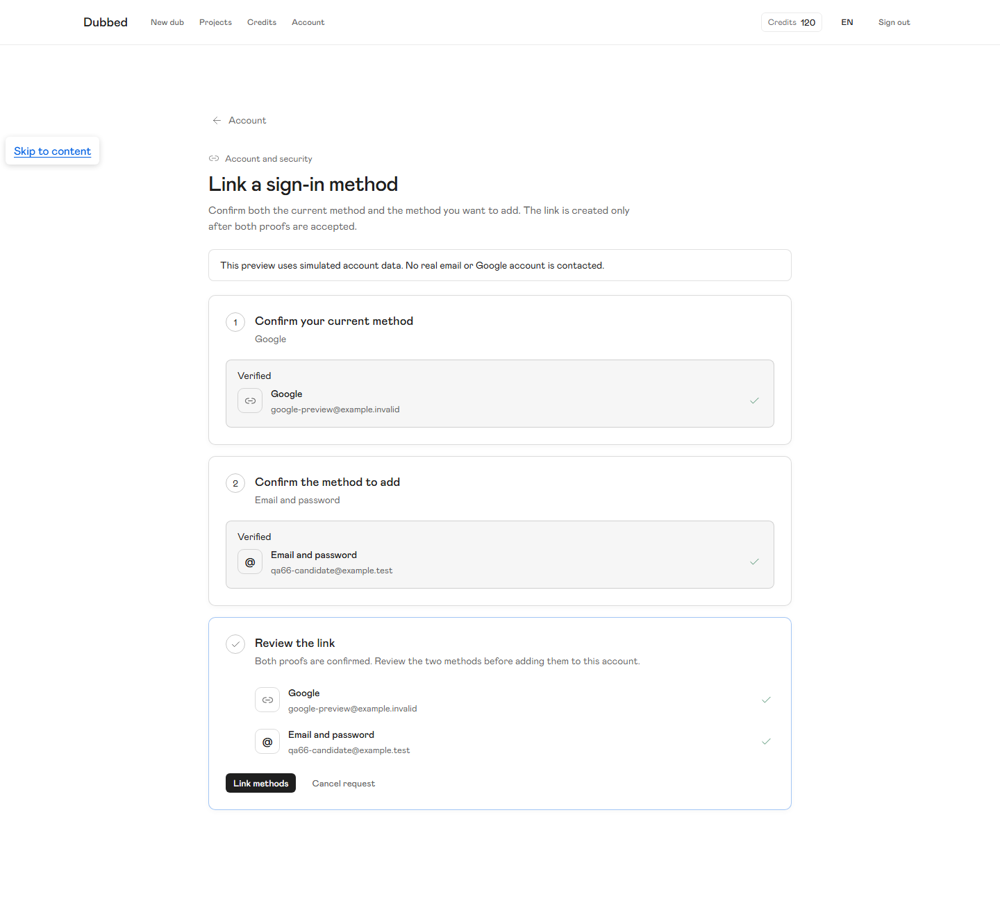 | 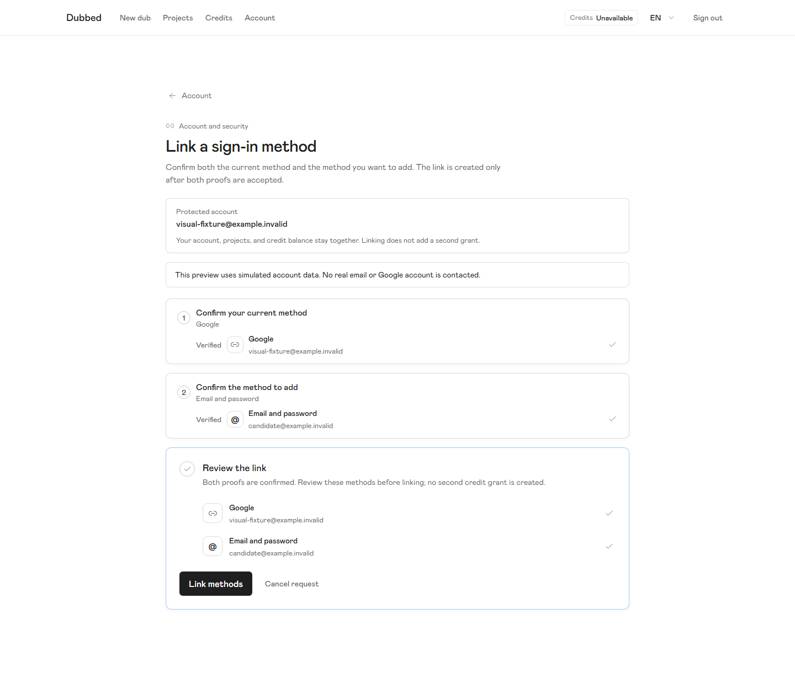 |

The after provides protected account identity and consequence information, and compresses completed proof rows. It is safer. It still repeats both identities in completed proof sections and the final review, with the commit action far below the header. This is a good candidate for progressive disclosure: completed proofs can remain concise while the current decision carries the identity pair and consequences. Do not merge proof operations or silently infer account association from matching email.

Reviewer caught phone overflow, invalid-code mapping, conflict retaining submit, and missing protected identity/consequences. Thus the failure was not a lack of security review. The remaining gap is economy and focus across proof→review→commit→success. Pending/unknown outcomes must remain persistent and reconcile; they must not become ephemeral “try again” toasts. Signed-out linking currently falls back to a placeholder in FeatureRoute.tsx lines 89–91; its standalone screenshot is not available in this audit.

## 6. New dub

Original #81 task (saved local body removed) · [Flow06](../../frontend-flows/06-new-dub.md) screen/selection/quote contracts · review #81 (local report removed) lines 43–111 · [receipt](../visual-qa-fixes-2026-10-25/issue-81/completion.md).

| Before: full-page current quote | After: 1440×700 current quote |
|---|---|
| 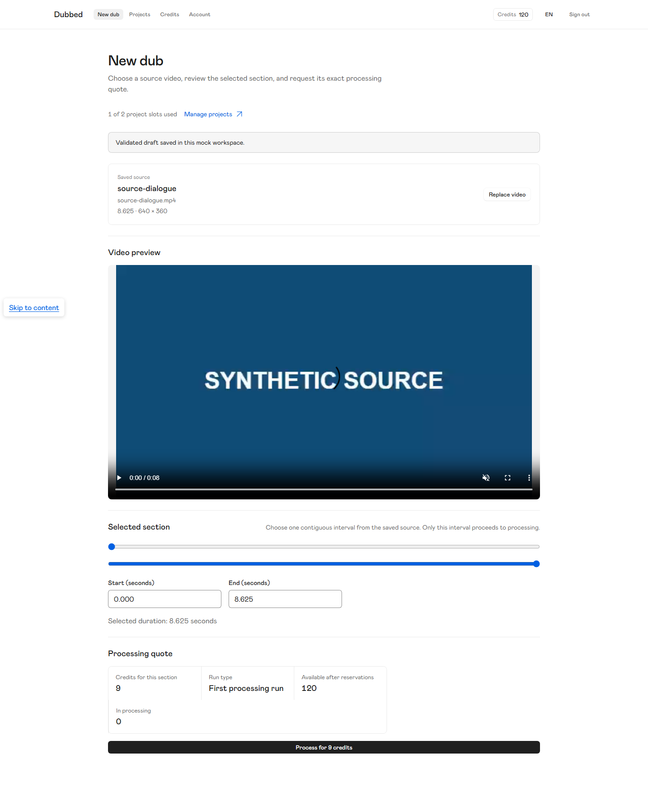 | 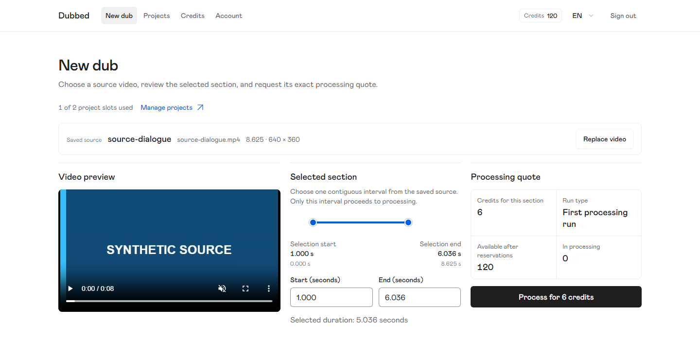 |

This is the strongest visible composition improvement in the sampled correction set. Preview, selection and price are now simultaneously available. Different intervals/prices mean this is not an accounting comparison. The original screen placed the work beneath a large media block and source metadata. Two separate slider domains were also a semantic defect, correctly caught by the reviewer.

Remaining design question: should the person select against the scene in one integrated timeline, rather than reconcile native video controls with a separate interval slider and repeated numerical endpoints? Millisecond input remains valuable precision, but it need not define the main mental model. Root later caught stale quote copy and an actual thumb hit-area gap; the captured after image predates some later touch/dirty-selection work. Current acceptance remains pending. Next proof must include upload/replacement failure, exact interval, quote invalidation, purchase-return requote, pointer/keyboard/touch use and explicit paid confirmation, not only fitting three columns.

## 7. Processing

Original #74 task (saved local body removed) · [Flow07](../../frontend-flows/07-processing.md) state/recovery/anatomy · review #74 (local report removed) lines 49–133 · [receipt](../visual-qa-fixes-2026-10-25/issue-74/completion.md).

| Before: running-known controlled fixture | After: running-known controlled fixture |
|---|---|
| 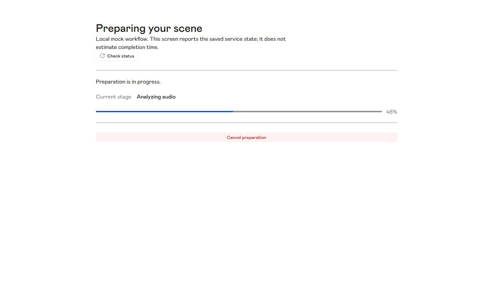 | 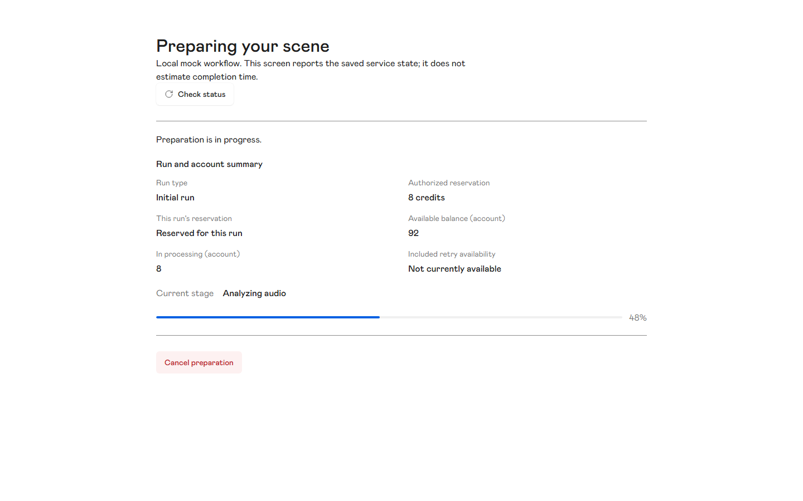 |

The original is sparse and lacks required accounting context. The after is more truthful but makes a six-fact run/account summary the central block, ahead of the stage/progress. This demonstrates that adding omitted requirements is not the same as arranging information around the person's decision. Prefer a concise state + safe-departure explanation, with the relevant held/charged amount and cancellation consequence close to their action; details can remain available without dominating every running state.

Reviewer caught invented queued 0%, missing preserved-preparation continuation, omitted accounting summary and a locked unknown-cancellation modal. These are serious recovery/usability findings. Corrections need to preserve them while reducing cognitive load. The pair is a fixture screen without the full native shell; do not infer ordinary route shell behavior from it. Native queued/running → ready, zero-turn initial versus replacement, failure/retry and cancellation unknown/settled transitions remain necessary whole-journey review states.

## 8. Microphone preflight

Original #69 task (saved local body removed) · [Flow09](../../frontend-flows/09-record.md) §4.1, lines 86–110 · review #69 (local report removed) lines 41–89 · [receipt](../visual-qa-fixes-2026-10-25/issue-69/completion.md).

| Before: ready desktop full-page | After: ready short desktop viewport |
|---|---|
| 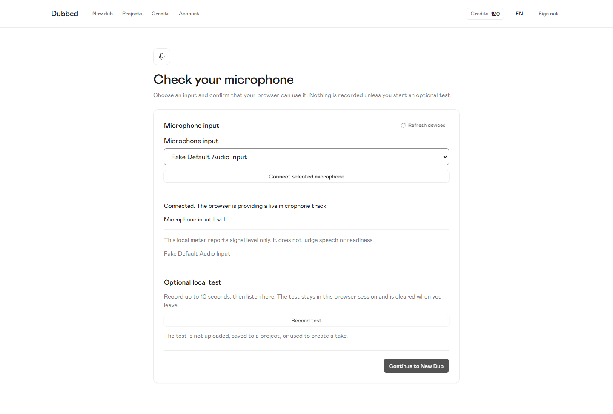 | 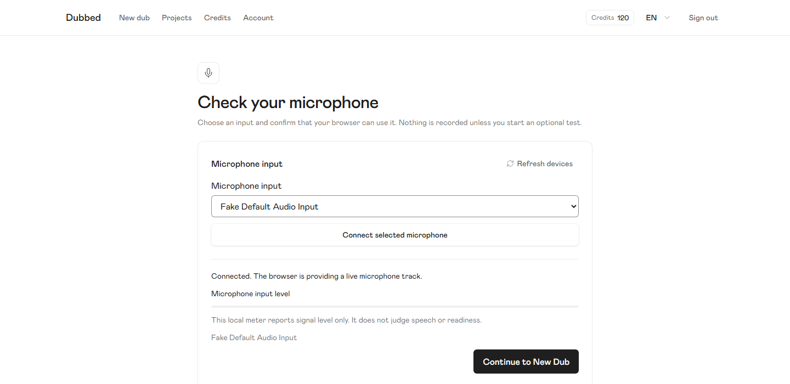 |

Continue now precedes the optional test and is visible at the bottom of the sampled 700px viewport. This solves the review's concrete ordering problem. The ready screen still has duplicated Microphone input labels, a connection action after connection, browser-track explanation, meter-policy prose and repeated device identity. A more economical readiness panel can say which input is selected, show it responding and offer Continue, with testing/reconfiguration secondary. Permission or lost-input recovery must still be actionable.

The two `origin` variants are one page with different return intent; they must be checked separately for candidate preservation and correct destination. Ready, not-asked, denied, lost and optional test states are recorded by the owner receipt, but only ready composition was directly inspected here. No physical mic behavior is established.

## 9. Record

Original #77 task (saved local body removed) · [Flow09](../../frontend-flows/09-record.md) §4.2 · review #77 (local report removed) · [receipt](../visual-qa-fixes-2026-10-25/issue-77/completion.md).

| Before: ready EN desktop | After: ready EN desktop |
|---|---|
|  |  |

The full causal chain and all 15 owner observations are in [report.md](report.md). This page's primary defect is the accumulated interaction architecture, not simply small buttons. Direct performance actions, centered dialogue and a contextual action rail are a reasonable next prototype. Preserve draft/accepted separation internally, clarify sequential advancement, and test repeated audition and rerecord before accepting any layout.

Audited states include original/corrected ready, short-height in-flow fallback, owner lower continuation and lost-access state. Historical review also exercised capture/candidate/acceptance/guard/second-tab denial; this audit does not claim fresh interaction with those. Missing independent proof includes end-cursor replay, actual live audio synchronization and all long-media states.

## 10. Result

Original #79 task (saved local body removed) · [Flow10](../../frontend-flows/10-result.md) displayed/authoritative generation and recovery · review #79 (local report removed) lines 37–131 · [receipt](../visual-qa-fixes-2026-10-25/issue-79/completion.md).

| Before: ready fixture | After: recovered descriptor fixture |
|---|---|
| 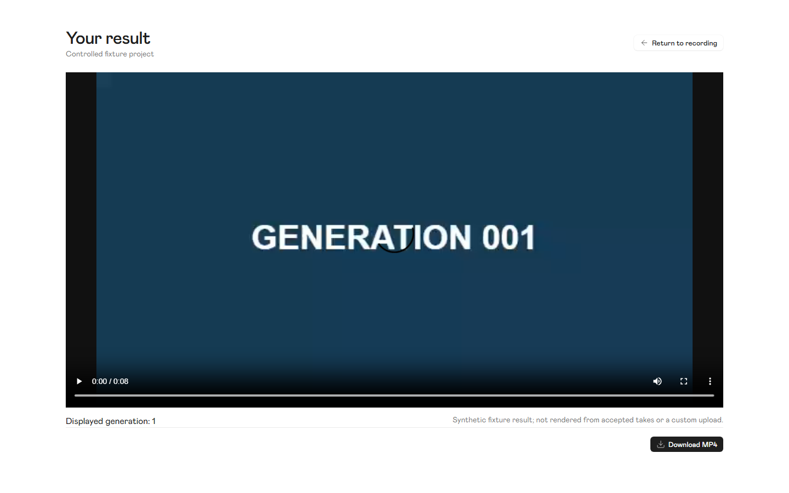 | 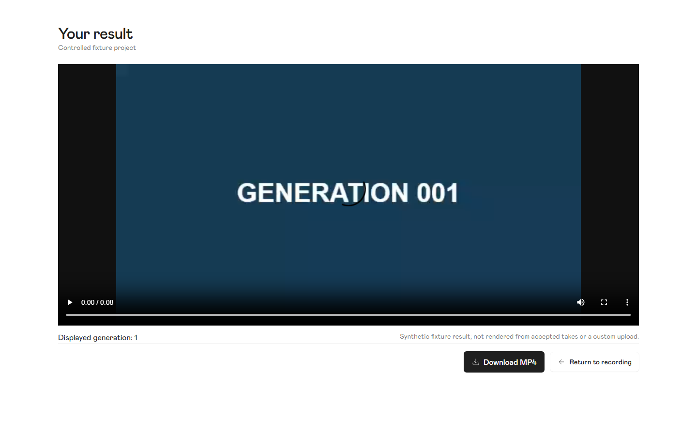 |

Download is more visible and grouped with return-to-recording. The after still has a media spinner in the chosen recovery capture, so it proves layout and recovery presentation, not fully settled playback. The reviewer found a genuinely blank unrecoverable descriptor failure, unlabeled previous version, unknown-download overflow, weak busy semantics and stage collapse. Root then caught the fix creating a second blank stage above a retained result, and the owner corrected it. This is evidence of competent bounded correction, not proof of cohesive final media UX.

A consumer should understand which version is playing/downloading and whether a new version is ready without learning “displayed generation” internals. Keep immutable generation identity in services; use user-facing version status only where it changes the decision. Must review first assembly, previous-playing/new-ready, Watch new paused at start, failed descriptor, pending/unknown download and revised return. These pairs do not prove exact downloaded bytes or real rendering from takes.

## 11. Projects

Original #75 task (saved local body removed) · [Flow11](../../frontend-flows/11-projects.md) rows/resume/deletion · review #75 (local report removed) lines 48–126 · [receipt](../visual-qa-fixes-2026-10-25/issue-75/completion.md).

| Before: desktop long titles | After: RU phone long titles |
|---|---|
| 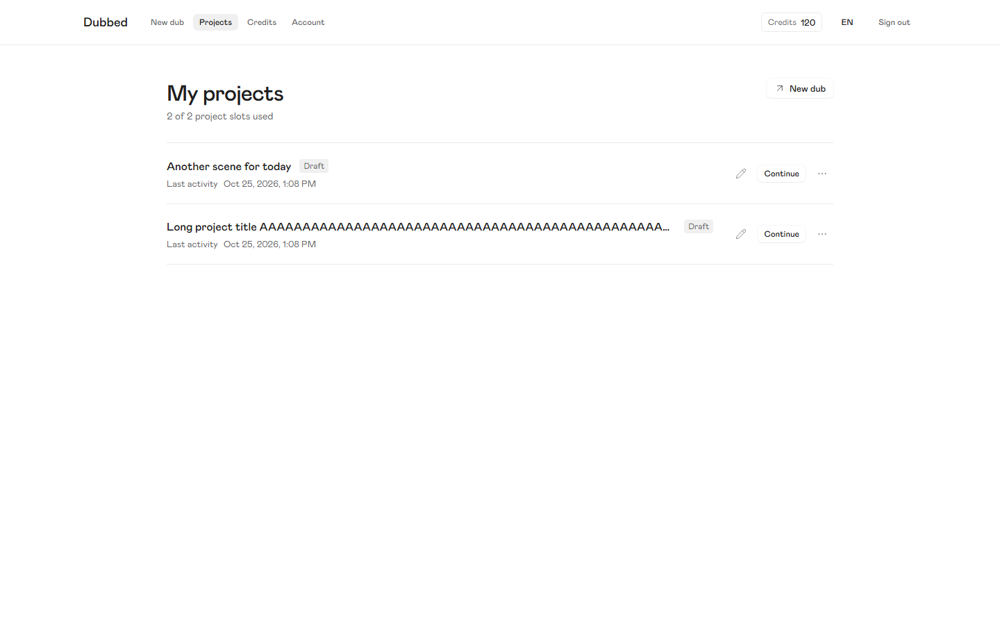 |  |

Different viewport/data; compare structure only. The correction contains titles/actions, supplies honest unavailable-preview slots and explains full capacity. A repeated “Preview unavailable” box is honest but visually unhelpful when every item has it. Strong truncation also makes similar filenames hard to distinguish. Do not fabricate thumbnails; give title/recognition sufficient space, expose full title in an accessible intentional way, and make resume status explain what Continue will open.

Reviewer caught missing preview/fallback, phone overflow/target width, missing continuing-charge deletion warning and capacity explanation. Those corrections preserve important lifecycle truth. Empty, mixed statuses, full capacity, rename, active-processing deletion and resume after zero-turn replacement need a task-based review; the current pair is not proof of each state.

## 12. Credits and purchase return

Original #65 task (saved local body removed) · [Flow12](../../frontend-flows/12-credits.md) purchase/history/return · review #65 (local report removed) QA-65-01–06 · [receipt](../visual-qa-fixes-2026-10-25/issue-65/completion.md).

| Before: verified history | After: pending history |
|---|---|
| 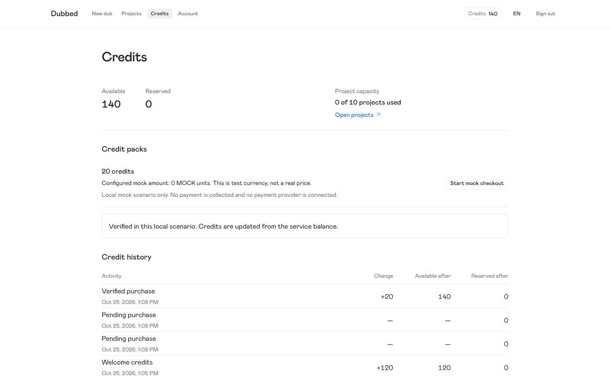 | 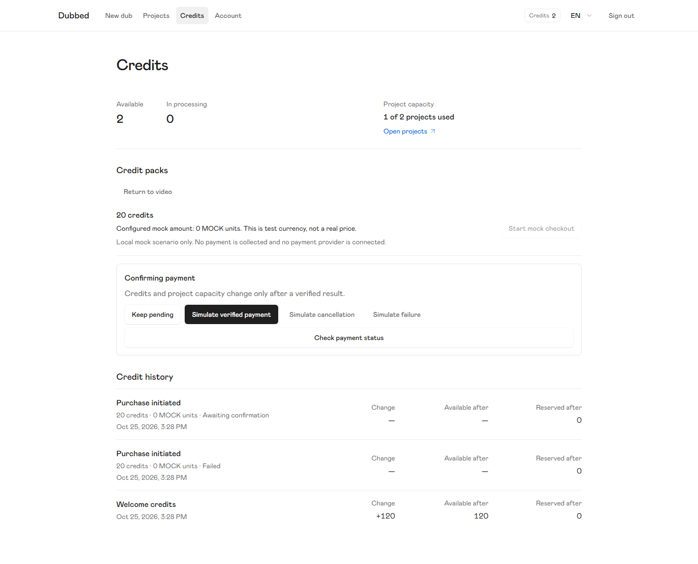 |

Different state/account/balance; no numerical before/after inference. The after clarifies in-processing balance and purchase observations, and Return to video exists. However, Keep pending / Simulate verified / cancellation / failure are the most substantial action group. That is a simulator, not the future purchase experience. It is valid local test functionality but must not be accepted as product UX. Repeated history labels and mock amount prose add weight without helping choose a pack.

Reviewer caught late reconciliation, stale/omitted history, missing cancellation return and return without fresh quote. Shared #68/#70 findings routed to #65 rather than duplicate writers; this was sound ownership. Next composition should separate scenario controls from the user surface, preserve unknown-result reconciliation without repurchase, and test return to the exact source/interval with a fresh quote and deliberate Process. No real price or payment behavior is inferred.

## 13. Account

Original #62 task (saved local body removed) · [Flow15](../../frontend-flows/15-account.md) account sections/guards · review #62 (local report removed) · [receipt](../visual-qa-fixes-2026-10-25/issue-62/completion.md).

| Before: desktop account | After: wrong-password desktop |
|---|---|
| 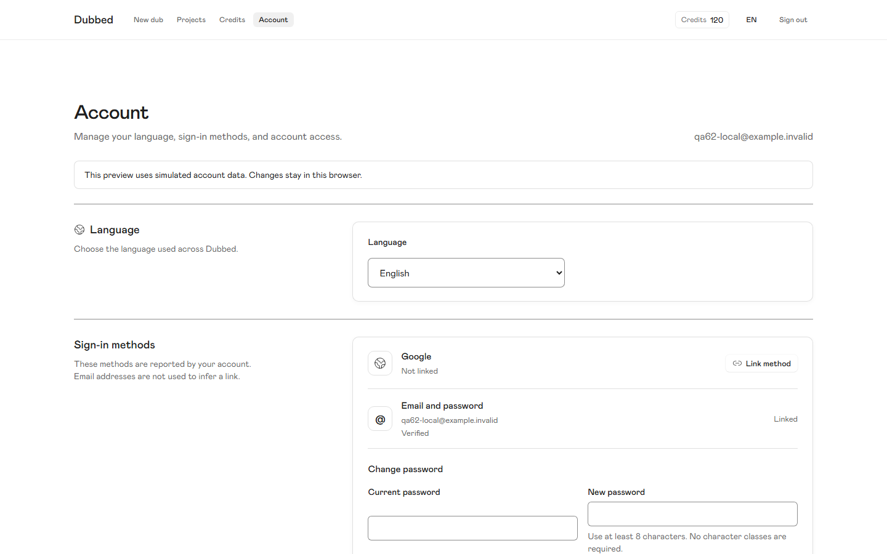 | 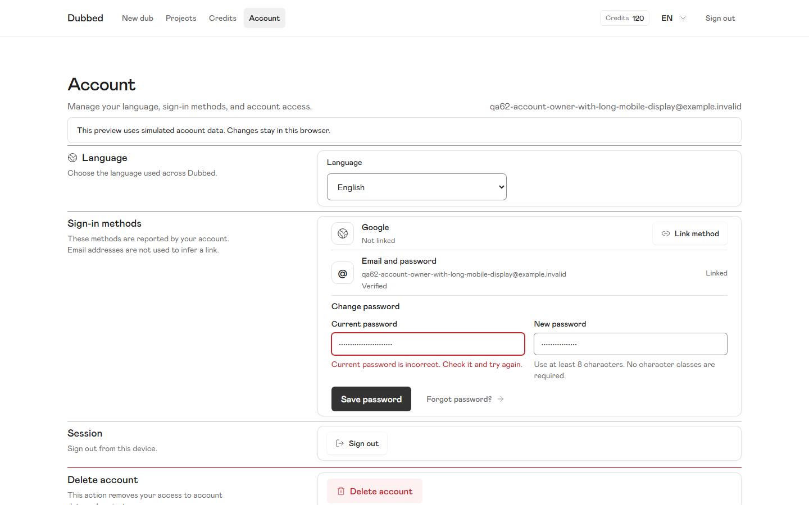 |

The after is materially better: aligned fields, field-specific error, readable action and more compact sections. It shows that a repair can improve hierarchy rather than merely increase size. The language card is still oversized for one choice; “methods are reported by your account / email addresses are not used to infer a link” is implementation-policy prose rather than normal task language. Preserve the policy internally and communicate only the consequences the person needs.

Reviewer found misleading password failure, pending locale behavior, deletion identity/disclosure and alignment/size issues. Deletion still warrants persistent explicit confirmation and consequences, not toast-only treatment. Language failure/rollback, method linking, password success/failure, sign-out with candidate guard and delete unknown/success must be reviewed as transitions. The stills do not prove account deletion or session isolation.

## Shared exceptional states and coverage limits

| Surface | Code/ownership | Evidence and audit disposition |
|---|---|---|
| Not found `/404` and invalid URLs | FeatureRoute.tsx lines 148–157; routes.ts final fallback; shared #78/#67 | Route existence confirmed. No matching before/after screenshot located or opened; visual quality unassessed. Expected outcome is clear home/recovery navigation without protected-data leakage. |
| Session checking/redirect/error | FeatureRoute.tsx lines 97–139; #80 + #68 | Expired-state pair opened above. Checking/redirect ordinary transient states not separately inspected; do not claim no flicker/focus issues. |
| Signed-out account linking placeholder | FeatureRoute.tsx lines 89–91; #66/#78 | Source confirmed; no standalone image. Its recovery/discoverability remains unassessed. |
| Storage/startup denial | #67/#73/#68 | Opened original `storage-open-denied-en-desktop.png`: it still appears as the ordinary landing. Review identifies the later failure/recovery gap; no after startup image independently inspected here. Keep this as a coverage limitation, not a claimed unresolved correction. |
| Header/phone menu/locale | #78 | Desktop shell appears in many native samples; source reference/control reviews exist. No fresh full keyboard/phone-menu review by this auditor. |
| Browser/media unsupported and permission failure | #64/#69/#72 | Foundation reports and correction receipts establish scoped work, not another page. No physical-device/browser-matrix validation performed here. |

The coverage is complete at the **primary-page inventory** level and representative at the **state/image** level. It is deliberately not a claim that all routes × states × locales × sizes × inputs were re-exercised. That stronger claim would require a new runtime review with the explicit scenario ledger proposed in the replacement workflow.
