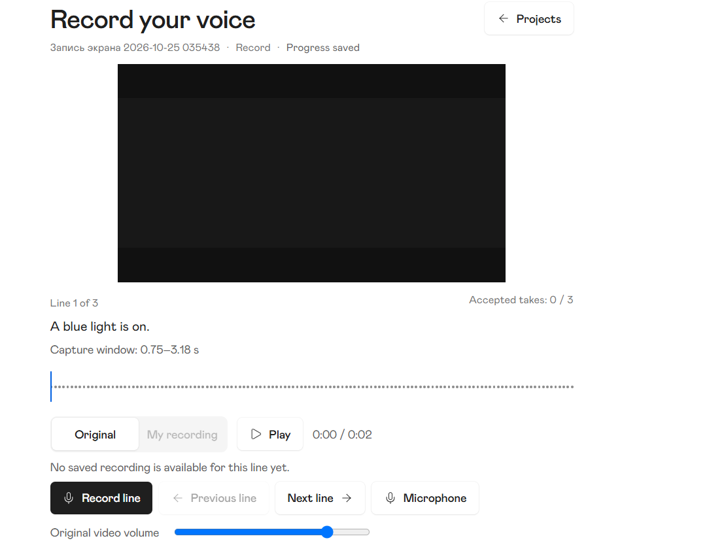
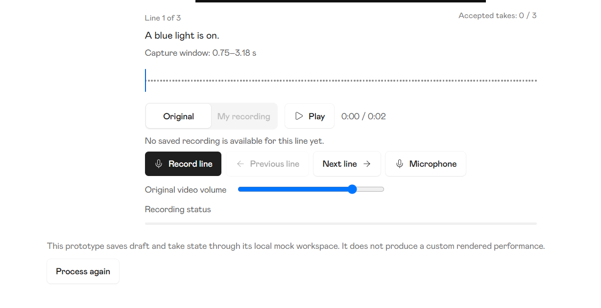
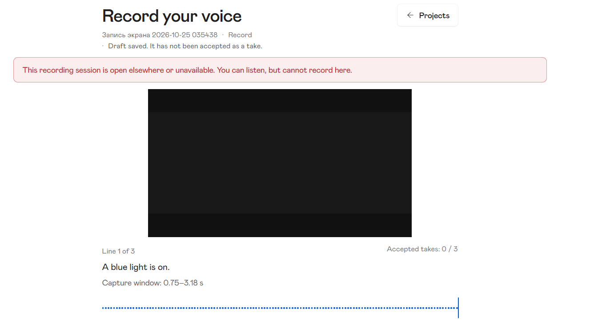
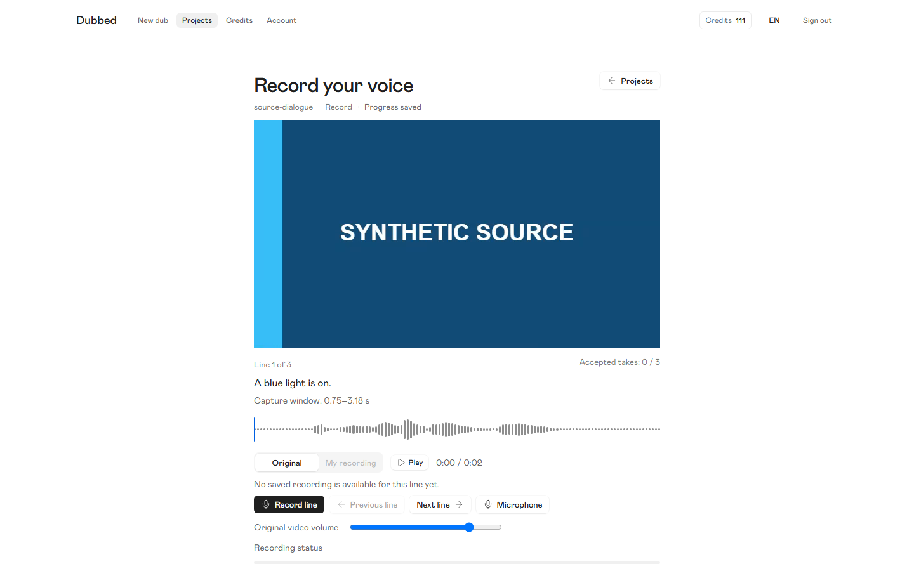
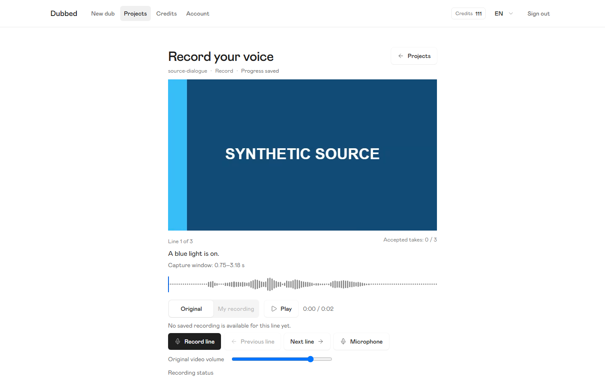
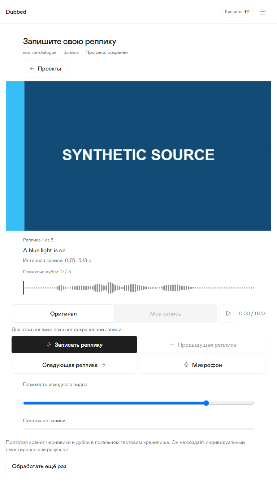

# Why the frontend can satisfy its tasks and still feel wrong

Audit date: 2026-10-26. Reviewer: GPT-6 Astra, Medium, explicitly requested by the owner. Review and reporting only. No product/spec changes, acceptance, Git/GitHub mutation, publication, or new runtime test is part of this audit.

The central failure is **a mismatch between what the delivery system optimized and what the person needs to do**. It optimized explicit state contracts, component fidelity, traceable task completion and bounded defect repair. It did not establish a compelling, economical, repeatedly usable end-to-end interaction before those contracts hardened. The resulting pages expose too much of the state machine, give supporting information similar weight to the actual job, and repeatedly treat fitting controls as equivalent to designing the work.

This is not evidence that every page is broken or that reviewers did nothing. Reviews caught important data-preservation, recovery, geometry and acceptance defects. Corrections visibly improved several pages. Nor does this uncontrolled history establish that Luna cannot design or Sol cannot review. Model, mandate, representation, fixtures, context, ownership, timing and acceptance criteria changed together.

Read [the page-by-page evidence matrix](page-evidence-matrix.md) for all 13 primary pages and shared exceptional states. Read [the replacement workflow and reusable prompts](replacement-workflow.md) for a practical way forward. The evidence boundaries and chat selection are in [evidence-inventory.md](evidence-inventory.md).

## What is established

| Finding | Priority and confidence | Consequence |
|---|---|---|
| UX-01: The recording interaction was specified as a collection of visible controls and status concepts before its repeated performance loop was validated | HIGH; confirmed document/image mismatch with present owner direction | Obedient implementation reproduces clutter; a compliance review cannot fix the underlying interaction without reopening the composition |
| UX-02: Component reference fidelity became a stronger executable criterion than page composition and task economy | HIGH; confirmed source mappings and review emphasis; causal weight is an inference | Correct buttons, fonts and shadows can coexist with a poor workspace |
| UX-03: Review and correction ownership followed issues, while the user's experience crosses pages and states | HIGH; confirmed packets and receipts | The feedback loop closes a list of QA IDs without proving that a novice can complete the whole journey comfortably |
| UX-04: Technical state, mock transparency and domain safety facts were translated too directly into persistent visible content | MEDIUM; directly visible across pages | Users must parse implementation explanations instead of seeing the next meaningful action |
| UX-05: Geometry and scripted checks were necessary but insufficient proxies for operability | HIGH; confirmed prior acceptance gap and correction regressions | No overlap and a green scripted journey do not prove discoverability, repeatability or honest completion claims |
| UX-06: Repeated audition at the end of a turn lacks an explicit reset in the current Play path | HIGH for the core repetition loop; owner-reported and source-supported, not independently reproduced | The most common rehearsal action can fail even while capture/acceptance tests pass |
| UX-07: The evidence kit under-challenged the product with realistic media and dialogue | MEDIUM; confirmed original fixture/review limits | A short title-card scene hides aspect-ratio, dialogue-length and performance-attention problems |
| UX-08: The process generated extensive prose and evidence without a compact, shared visual decision artifact | MEDIUM; confirmed artifact shape; attention/context effect is an inference | Important choices remain scattered across long documents and late correction packets |

These priorities concern the next UX iteration, not newly authorized issues or a claim of production risk. Current corrections remain local and unaccepted. The parent checkpoint reports 37/38 focused integration tests passing with one New dub pointer-driver failure; this audit did not rerun or resolve it. Historical accepted milestone evidence is not acceptance of the correction boundary.

## UX-01: Recording makes the problem unusually clear

The current owner images show a heading and project/status trail; centered video; left-aligned line position and spoken text; a separate accepted-take count; exact capture-window timestamps; an unframed waveform; source toggle plus Play; a disabled-source explanation; Record/Previous/Next/Microphone; a standalone volume row; Recording status; a mock implementation disclaimer; and Process again outside the central work area. The first screenshot alone contains multiple competing definitions of progress and several different widths/alignment axes.

The causal chain is unusually well evidenced:

1. The original published Original # task (saved local body removed), lines 29–41, explicitly requires the largest video, smaller target, waveform, common transport, Original/My recording toggle, separate position/accepted counters, reference volume and Process again. Line 54 constrains desktop controls below the waveform and phone pinning; the current Flow09 also explicitly requires Microphone access. These were executable requirements, not inventions by the implementation model.
2. Current [Flow09](../../frontend-flows/09-record.md), lines 64–81 and 109–178, retains that anatomy. It calls the spoken target a **small** line while asking the user to perform it. It prescribes both semantics and placement in prose, without demonstrating that the complete composition works for repeated rehearsal.
3. The original review # (local report removed) found a disabled Back guard, 767px overlap and undersized desktop actions. It also praised the large scene, target and waveform as a coherent rehearsal-room identity and the two progress concepts as distinct. The reviewer did not merely omit visual inspection: original chat tool calls show actual image opening (see evidence inventory).
4. The correction [execution packet](../visual-qa-fixes-2026-10-25/EXECUTION-PACKET.md), ownership entry 77, assigns those three bounded repairs. The [completion receipt](../visual-qa-fixes-2026-10-25/issue-77/completion.md), lines 9–15, reports exactly those dispositions. The after image enlarges controls while keeping the interaction architecture.
5. Root caught an incomplete fit calculation and required the entire dialogue/waveform to clear the panel. That was good verification of a real defect. It still left the target subordinate, related actions split across rows, and technical/status clutter intact. It answered “does this fit?” rather than “is this the right interaction?”

| Original review state | Bounded correction state |
|---|---|
|  |  |

The correction is real but does not solve the owner's complaint. It made the existing design larger and safer. That is a different outcome from simplifying the task.

### All 15 owner observations

The owner direction is input to the next design, not authorization to implement changes during this audit. “Agree” below means the critique is supported; it does not claim a replacement has been tested.

| # | Owner observation | Assessment, provenance and next design decision |
|---|---|---|
| 1 | Remove filename / Record / Progress saved below the heading | **Agree on hierarchy; refine retention.** They compete with the work and repeat context. Flow09 lines 80, 113–118 requires project/save identity. Keep project identity available in the shell or overflow and show save state only when meaningful; retain persistent failure/recovery status. Do not remove the underlying persistence distinction. |
| 2 | Capture timestamps are technical clutter | **Agree.** Owner image 1 makes them nearly as prominent as the dialogue. Fixed timing remains a domain invariant; exact window boundaries need not be everyday copy. Show useful audition duration/playhead; place diagnostic timings in a test/developer surface or deliberate detail view. |
| 3 | Accepted takes is redundant under mandatory sequential acceptance | **Agree under the owner's new intended flow; historical conflict.** Flow09 lines 119–126 explicitly permits candidate-free Next, and lines 172–178 define missing-take recovery. The original task line 36 also permits gaps. Under that prior policy, turn position and accepted count are not equivalent. Resolve sequential advancement and revisiting/re-recording semantics first; then one progress treatment can replace redundant counters without falsely claiming completion. |
| 4 | Replace Original/My recording switch with Replay/Your take | **Agree as a promising simplification, not yet validated.** The old toggle is explicitly mandated in Flow09 lines 137–146. Direct actions reduce the select-source-then-Play sequence. Define Replay as original turn audition, Your take as current candidate before accepted take, repeat-at-end behavior, pause behavior and accessibility names. Preserve one playing source and candidate precedence. |
| 5 | Group Replay/Record/Your take apart from navigation | **Agree.** They are the local performance loop; Previous/Next change task context. Existing images mix them across two rows and give Microphone equal position. Test spacing and visual grouping with ready, capturing, candidate and saving states, not just an empty line. |
| 6 | Mic setup was already preflight; reconfigure in Settings | **Agree with recovery access retained.** Flow09 line 158 requires explicit Microphone. Routine setup can move out of the primary loop; loss/denial still needs a contextual “Microphone settings” recovery action. “Settings” location and return-with-candidate behavior are a contract change to settle, not assumed existing navigation. |
| 7 | Rectangular waveform container | **Agree with purpose.** A bounded frame can make the scrub region and its relation to audio obvious. Preserve keyboard seeking, focus, readable duration and candidate/source distinction. Do not turn it into an editable timeline or introduce arbitrary decorative boxing. |
| 8 | Remove Recording status | **Agree for the idle label/empty track.** Owner image 2 shows it consuming space without information. Active capture still needs unmistakable visual and programmatic feedback because it cannot be stopped manually (Flow09 lines 206–210). Put state on Record/control region or waveform; remove redundant idle chrome, not feedback. |
| 9 | Process again and errors break the bounded layout | **Agree.** Image 2 shows Process again on a wider outer axis; image 3 shows an unrelated-width error above the scene. Use one intentional workspace boundary and a secondary utility location. Preserve reprocess cost, warning and permanent lock semantics; do not hide a consequential operation in an ambiguous icon. |
| 10 | Play at the finished cursor does not restart | **User-reported, source-supported behavioral defect.** RecordingScreen.tsx lines 1010–1019 pauses at the turn end; lines 1034–1062 calls play without resetting an ended turn window. A media element may not be at the source file's end, so native replay behavior cannot repair this boundary. Reproduce Original → window end → Play, candidate → end → Play, scrub to end → Play, in both languages and sources. This audit did not execute that reproduction. |
| 11 | Integrate volume with custom video audio UI | **Agree with semantic caution.** The current long separate slider competes with recording controls. It controls audible reference only, not microphone capture or final mix (Flow09 lines 147–150). A custom player must label that distinction, remain operable by keyboard and avoid suggesting it changes the saved take. |
| 12 | Deliberate variable media aspect ratios | **Agree; reject automatic “letterboxing is a bug.”** Existing selected media may legitimately require contain/letterbox. The problem is untested composition, not black bars alone. Allocate a bounded stage for landscape, portrait and square; keep the full image uncropped by default, preserve dialogue/action visibility, and test short screens with realistic moving content. Black owner images alone do not prove decoder failure. |
| 13 | Errors should be bottom-center toast | **Agree that placement is poor; refine universal toast.** A transient success notification can use a bottom-center toast with live announcement. Lost recording access, unsaved audio, denied microphone or unknown acceptance require persistent actionable state tied to the affected controls. A disappearing toast would leave disabled Record unexplained and can be missed while speaking. Keep error height bounded and avoid displacing the scene; retain text until resolved/dismissed where safe, with focus/announcement rules. |
| 14 | Dialogue underemphasized and hierarchy overloaded | **Agree, high priority.** The text to perform is the work object, not metadata. Flow09's “small readable line” and image geometry encourage the present hierarchy. Make a centered, clearly readable dialogue region with a deliberate line-length/long-caption strategy; video can remain dominant without making speech text incidental. Validate while actually following the scene. |
| 15 | Desktop video → centered dialogue → boxed waveform; right sidebar with clip position → replay/record/take → navigation | **Strong proposed direction consistent with the job; shared contract revision required.** Current spec says no permanent sidebar and controls below waveform. Prototype the owner direction using real states before rewriting all tasks. A contextual performance rail differs from global navigation. On narrow/short screens, collapse to one reading order, keep dialogue and primary performance actions together, and allow intentional scrolling rather than shrinking the video/text to satisfy a fit assertion. Resolve “Next” acceptance and backward navigation before final labels. |

The short-screen correction illustrates why this needs a composition decision rather than another clearance calculation: its full-page image is readable, but the initial 767×600 viewport ends inside the video and the dialogue/actions require scrolling. This is not overlap; it is a different usability tradeoff that must be consciously evaluated.

## UX-02 and UX-04: A component library cannot supply the product hierarchy

The inspected Affect button and segmented-control PNGs are component specimens. Their source defines 28px/13px medium controls (button Clean lines 309–314; segmented Clean lines 546–552), dark primary/white secondary treatments and component shadows. It does not decide whether a dubbing workspace needs two transport modes, where dialogue belongs, how many accounting facts remain visible, or whether the next task requires scrolling.

The adoption workflow itself correctly says feature owners own composition and derivatives are not nonexistent library components. The failure is not the existence of a reference. It is that exact source values and states became easy to verify, while “the screen's first question” remained aspirational prose. The #77 review demonstrates this: measured compact fidelity was recognized and challenged, but the surrounding composition was still praised. The later 40/44px policy fixes one axis. It cannot reconcile three separate action groups or remove redundant information.

The same pattern appears beyond Record:

- **New dub:** the original document-like vertical stack separated the scene, interval and quote. The correction's three columns materially improve simultaneous visibility. Yet the split native player/selection controls and repeated precise timestamps still require an intentional editing model. Current touch-target work shows why a 48px box did not prove a usable drag area.
- **Microphone:** Continue moved ahead of optional testing, a meaningful information-order repair. The ready screen still spends many lines on browser track, meter limitations and local-data policy before the user continues.
- **Linking:** identity/consequence information was added and completed proof cards shrank. The final decision still repeats the same identities in a long stack; the action is below the first viewport in the inspected full-page after image.
- **Processing:** adding missing reservation/settlement information improves truth, but the running state now puts a six-fact account/run summary ahead of the progress bar. The user chiefly needs “what is happening, may I leave, and what does cancellation do?” Financial details belong where they inform that decision, with a concise summary and accessible detail if needed.
- **Authentication and Credits:** honest mock notices are valuable evidence boundaries. Repeating simulator explanations inside every task region makes the prototype feel like a test harness. Use one unmistakable prototype indicator and a separate simulation/debug surface; keep localized task errors and real cost/consequence disclosures in the product UI. Do not remove honesty or present fixtures as genuine rendering.

These are composition judgments grounded in the images, not newly demonstrated runtime failures. Proposed simplification must preserve account ownership, unknown-outcome reconciliation, credit settlement, draft safety, authorization, generation identity and one-capture-at-a-time behavior.

## UX-03 and UX-05: What reviews caught, and why the cycle did not converge

The readable original conversations show a consistent mandate and focus:

| Stage | Direct conversation evidence | What it establishes |
|---|---|---|
| Initial Record author | `spec_flow09_record.md`, original lines 144/162, 2026-10-21 19:29:16 / 19:31:47 UTC | Author preserved confirmed decisions and marked discretionary layout/control semantics open; explicitly produced no mockup |
| Media spec review | `independent_media_spec_review.md`, original lines 162/231, 2026-10-22 17:05:06 / 17:07:43 UTC | Focus on persistence, final-take exit and assembly authorization; important contract gaps were caught |
| Package spec review | `independent_package_spec_review.md`, original lines 177/194/248, 2026-10-22 17:08:41–17:57:08 UTC | Caught zero-turn preservation and lost purchase-initiation identity; independently rechecked corrections |
| Task grooming | `review_frontend_task_package.md`, original lines 85/169/243, 2026-10-22 20:02:34–20:10:19 UTC | Reviewed lifecycle/identity boundaries and added player-delivery recovery verification; explicitly did not claim runtime readiness |
| Dependency review | `review_frontend_task_dependencies.md`, original line 206, 2026-10-22 20:09:45 UTC | Verified 22 tasks and 12 dependency waves; this proves task graph coherence, not a coherent visual journey |
| Affect migration review | `review_affect_adoption.md`, original lines 89/232/331, 2026-10-22 22:57:13–23:09:19 UTC | Inspected reference PNGs and provenance, caught phone type/corrupted clauses/shadow wording; final claim explicitly excluded rendered acceptance |
| Proactive visual review | `visual_qa_77.md` line 283, `visual_qa_81.md` line 249, `visual_qa_63.md` line 346 | Identified actual guard/overlap/selector/composition defects and overbroad acceptance; these were not blanket PASS reviews |
| Recording correction | `fix_77.md`, original lines 90/843/1710/1930, 2026-10-25 10:54:01–11:47:48 UTC | Executor scoped itself to three findings; initially reported target clearance; Root later required full dialogue/waveform clearance, which was repaired |

All chat filenames above are linked in [evidence-inventory.md](evidence-inventory.md). Original line/timestamp labels refer to JSONL records, not Markdown line numbers. Opaque agent message payloads cannot establish their content.

The original visual dispatch **did** ask for two lenses: compliance and product/design quality, including criticism of approved small controls. Therefore “the reviewers were only allowed to check specs” is false for that review wave. However, the same packet bounded each reviewer to one issue, roughly 15–25 minutes where practical, with extensive state/viewport/source/metrics requirements. It asked for screenshot-backed findings rather than a demonstrated alternative composition. The reviewers' judgments were therefore locally useful but did not replace a design owner for the whole task flow.

The numerical report totals—21 reviews, 401 images, 87 findings including duplicates—measure activity and coverage, not the quality of one complete journey. The frozen README explicitly rejected blanket acceptance. The subsequent correction packet transformed that report into exact QA-ID completion work and a shared density policy. This made the repair executable, but also narrowed success to the findings already enumerated. Root's subsequent checks caught regressions, false notices, type seams, hidden waveform and touch-target defects. Those are real gains. They did not introduce a separate product-level judgment of whether the screen should contain the elements at all.

The original #63 review documents a concrete acceptance failure: a broad checked visual criterion included current native-zoom evidence that was missing or only approximated. Its report lines 55–78 distinguish required proof from proxy. That earlier acceptance was too broad. Conversely, the current correction packet and receipts explicitly withhold integrated acceptance. These must not be collapsed into “everything was falsely accepted.”

A deeper failure is **late composition review**. Once the spec, tasks, tests, implementation and accepted historical record all encode the same anatomy, a reviewer must challenge five layers to remove a redundant label. Earlier reviewing a connected prototype would have made that choice cheap. More late reviewers alone would add overhead while preserving the same incentives.

## UX-06 and UX-07: The core loop needs behavior and realistic media

The replay issue is especially diagnostic. A scripted journey can record three lines, press Next and download the expected fixture without ever replaying the same turn after reaching its end. An image of Play, a correct waveform and successful capture do not exercise that operation. The current source supports the owner's report, but this audit deliberately does not upgrade it to a freshly reproduced browser defect. Add repeated rehearsal as a named scenario, with actual assertions that video/audio return to the turn beginning and advance again.

The old short 16:9 title-card fixture was transparent and lawful, and useful for deterministic timing/identity checks. It was a poor sole basis for visual quality. The original #72 review already raised this. The correction added portrait/long-selection fixtures; that is progress, not proof of realistic performance quality. The owner screenshots use a different source with a dark stage and an extremely simple supplied line. Do not infer actual transcription quality, media failure, original aspect ratio or production mixing from these stills.

The next composition trial needs a permitted realistic scene, landscape/portrait/square media, a long Russian line, multiple speakers, a pause, an unaccepted candidate, a failed save and a completed project being revised. Separate technical timing fixtures from human-facing design fixtures. Preserve reproducibility for both.

## UX-08: Context and model attribution

The active Flow09 is about 133KB; shared contract about 113KB; New dub about 111KB at the inspected boundary. Each contains substantial behavior, history, mapping and acceptance material. These sizes are facts, not proof that a model exceeded context or forgot a rule. The initial author, later synchronizers, token migration, implementation and correction actors inherited different subsets and mandates. A plausible mechanism is attention being spent reconciling repeated clauses while the composition is treated as settled. That remains an inference; no hidden model reasoning is claimed.

Actual `turn_context` metadata in the chat index identifies initial flow authors as GPT-5.6 Sol High, later spec/review actors as GPT-6.1 Sol High, correction executors such as #77/#81 as GPT-6 Luna Max, and the inspected Root logs as GPT-6.1 Sol **Medium**. The current audit is GPT-6 Astra Medium by owner request. Preferred role policy is not evidence of the actual model/effort used. It would be misleading to explain the outcome simply as “Luna implementation versus Sol High review.”

A falsifiable comparison would give two or three models the same compact journey packet, identical source reference, realistic assets, tools, time/token budget and frozen requirements. Ask each for the same connected Record→Result prototype, then run the same repeated-use and recovery scenarios. Blind the model names and counterbalance evaluation order. Compare task completion without hints, wrong-action counts, repeated audition success, visible next-action comprehension, long-dialogue readability, recovery correctness and independent preference reasons. Repeat with more than one scene and at least two runs per model. Keep model comparison separate from the workflow comparison: first test a connected prototype mandate versus the old compliance-heavy mandate with the same model. A model effect is credible only if it survives those controls.

## Scope and confidence

**Confirmed:** current route inventory; the inspected before/after visual structure; explicit recording anatomy obligations; actual reviewer findings and correction scope; readable chat focus; source-level missing end-window reset; prior umbrella evidence mismatch; current withholding of correction acceptance.

**Refuted by evidence:** reviewers never looked at images; all flaws were invented by executors; compact controls were universally implementation deviations; the latest correction wave is already accepted; screenshot/test counts establish cohesive UX.

**Partial/inferred:** why each actor overlooked broader hierarchy; the relative contribution of long context, per-issue decomposition, time pressure and model capability; whether the proposed right rail outperforms alternatives.

**Unconfirmable in this audit:** physical microphone/speaker behavior, production/backend/payment behavior, full accessibility conformance, fresh runtime replay reproduction, all 401 historical images, every historical conversation, every state on every route, and subjective novice usability without observation. The page matrix names these limits rather than turning representative images into blanket acceptance.

The next useful step is one coherent, realistically populated, operable dubbing journey with the owner's recording direction and explicit state transitions. Review that experience before expanding the documentation or dispatching another issue-by-issue polishing wave.
