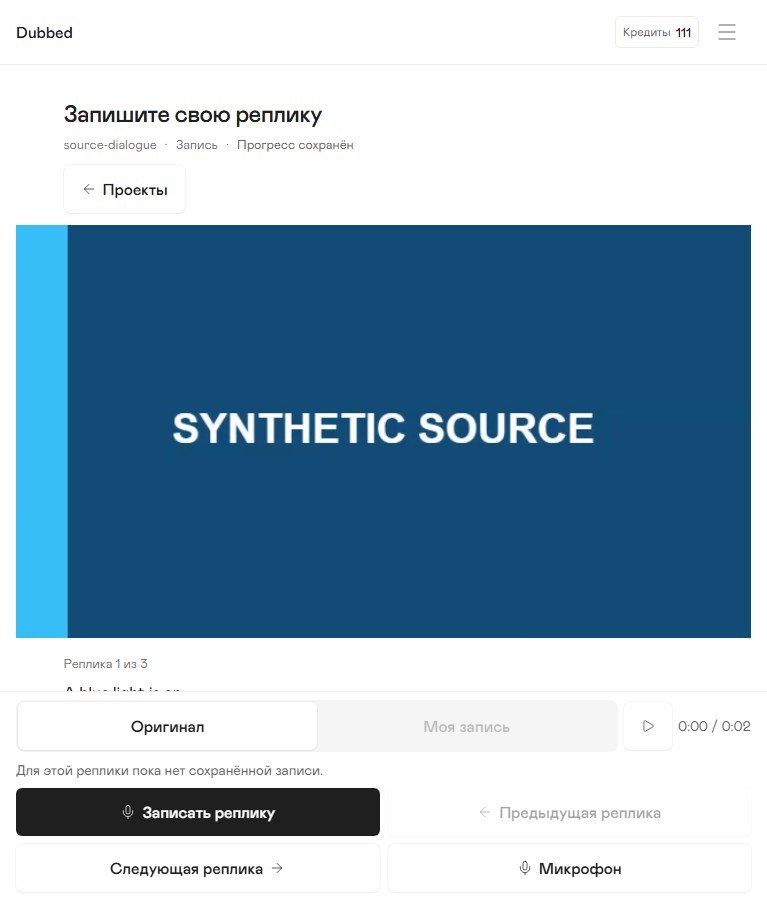
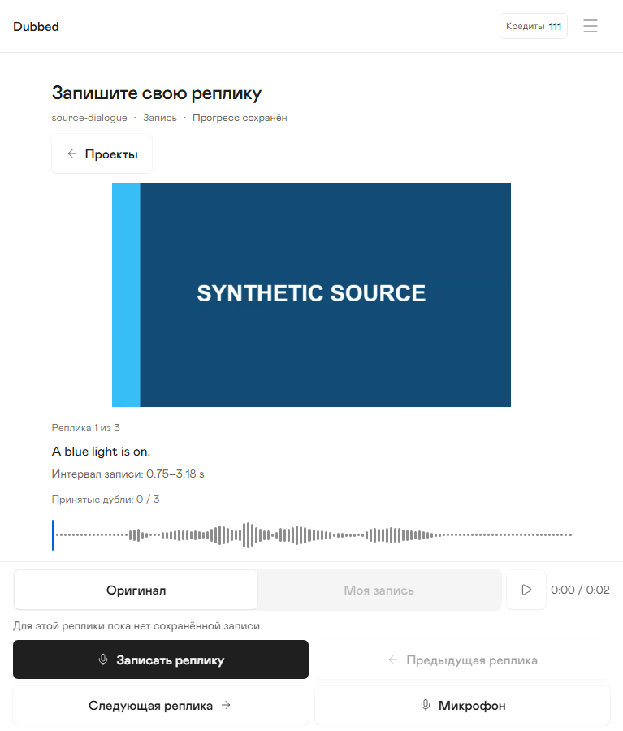
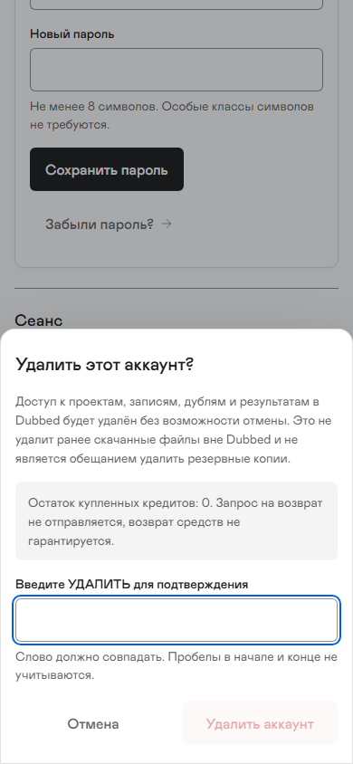
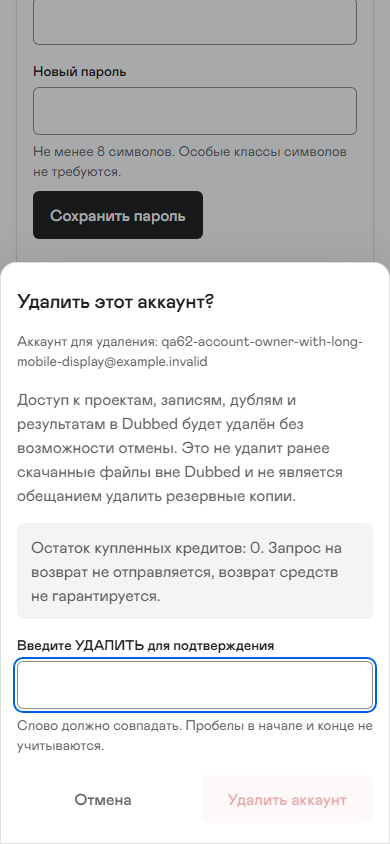
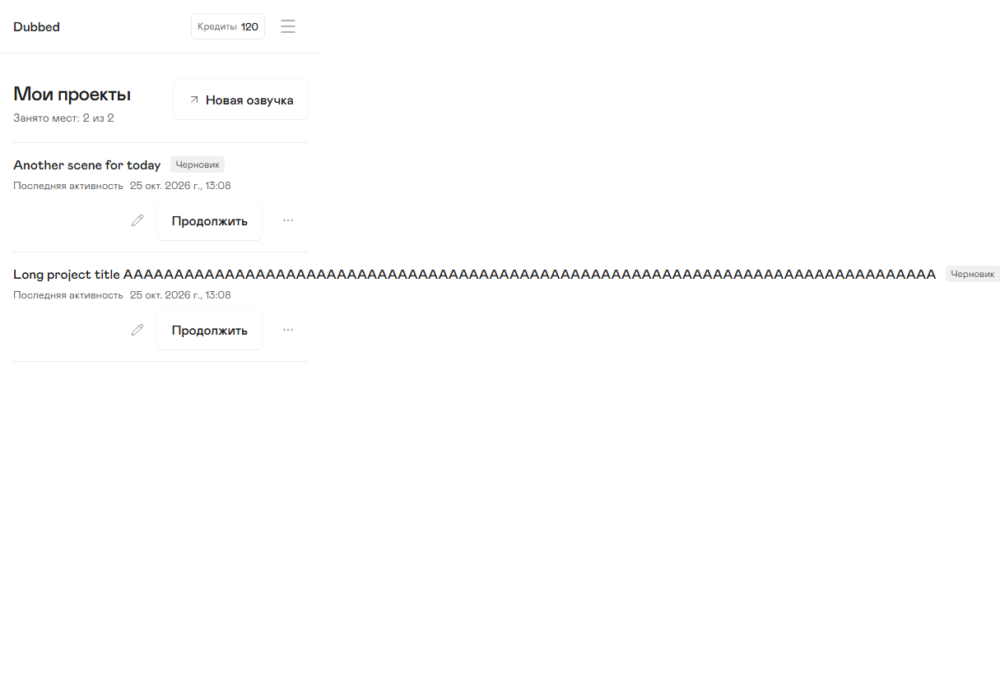
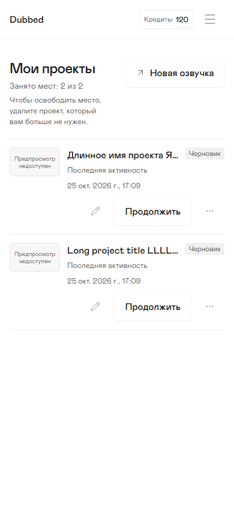
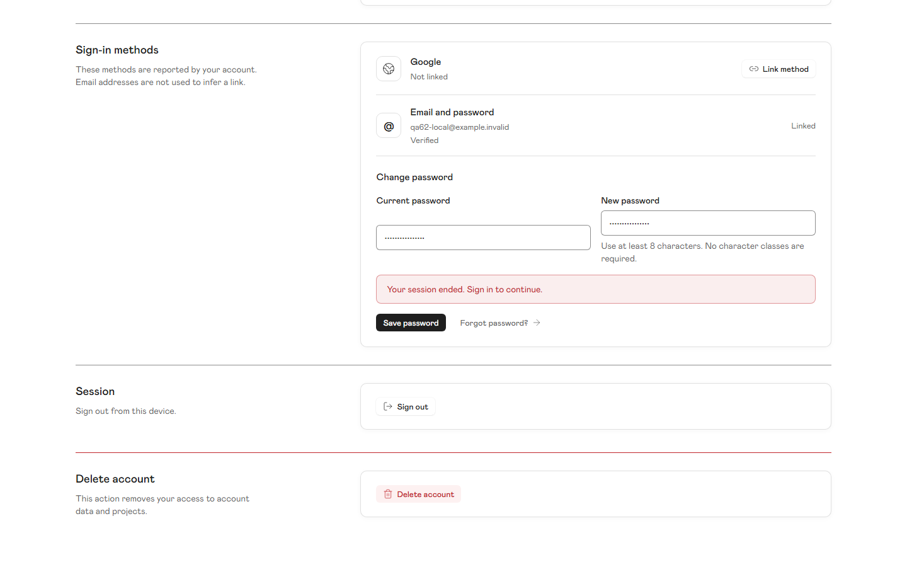
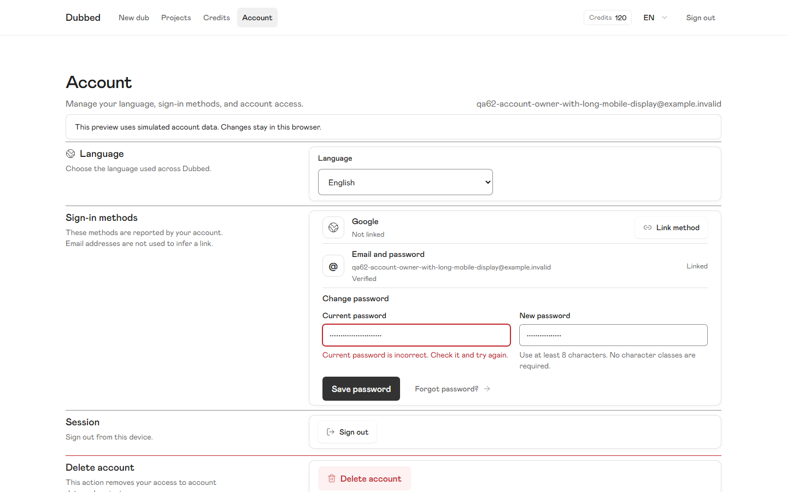
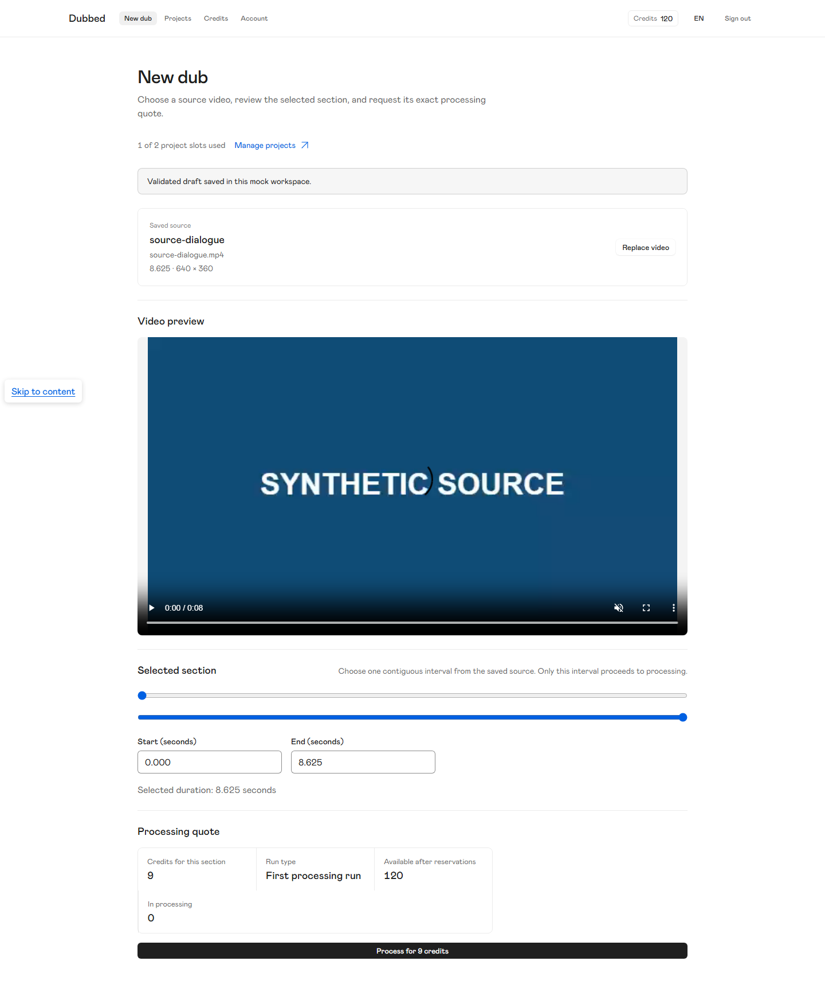
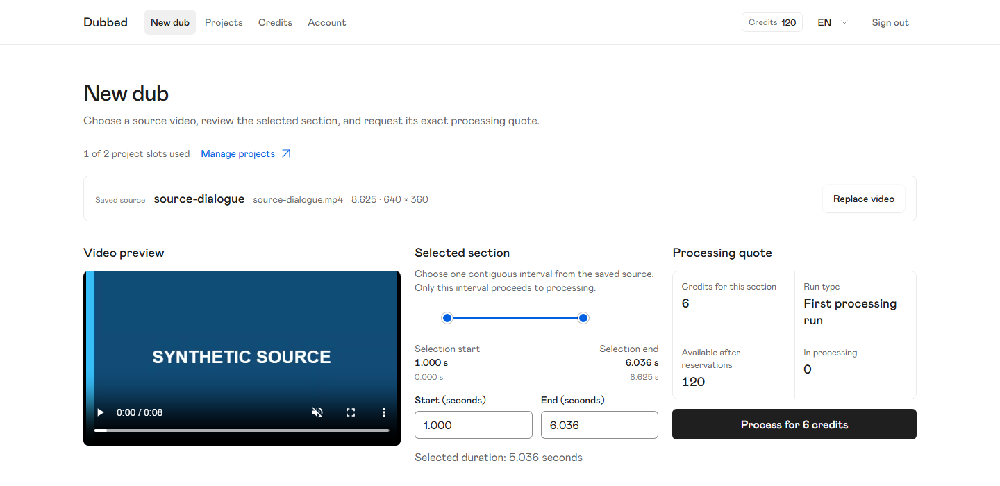

# Before and after: verified correction examples

These are actual saved browser screenshots, not proposed mockups. Before images belong to the frozen independent review; after images belong to the dedicated correction owners. Root reopened every image in the pairs below. This gallery does not grant final integrated acceptance or imply that unfinished corrections are complete.

## Recording: complete content above the controls

Both captures use the767×900 Russian layout. Previously the fixed panel covered the dialogue, capture interval and waveform. The corrected scene budget keeps the complete required content above the panel; constrained-height layouts use the documented in-flow fallback.

| Before | After |
|---|---|
|  |  |

## Account deletion: identify the account and improve disclosure readability

Both are390×844 Russian confirmation dialogs. The after case deliberately uses a longer synthetic address to exercise wrapping; the before case had no account identity. Financial and deletion disclosure now uses16px/24px text.

| Before | After |
|---|---|
|  |  |

## Projects: contain long names

Both use a390px Russian viewport and long synthetic project names; test data differs. The before full-page image is wider because the title expanded the document beyond the viewport. The after image contains titles, status badges and actions; full titles remain available to accessibility APIs. Unavailable previews are explicit placeholders, not invented thumbnails.

| Before | After |
|---|---|
|  |  |

## Account password correction: report the actual error

Both show the wrong-current-password state at1440×900. Scroll positions and synthetic addresses differ. Previously the error incorrectly said the session ended and the two fields were misaligned. The after state identifies the current-password field, retains entries, aligns the inputs and uses the larger task action.

| Before | After |
|---|---|
|  |  |

## New dub: preview, interval and quote together

Before is a full-page1440px-wide capture of the long vertical screen. After is a1440×700 viewport capture with decoded media ready, after FIX-R81-01. The selected intervals differ (8.625s before,5.036s after), so compare composition rather than prices. One shared-domain two-handle interval replaces the separate differently scaled sliders; the preview, fields, quote and larger processing action fit together.

| Before | After |
|---|---|
|  |  |

[All dedicated executor receipts and current scope](README.md). Screenshots prove only the named rendered states; operation identity, settlement and recovery invariants also require their linked tests and traces.
