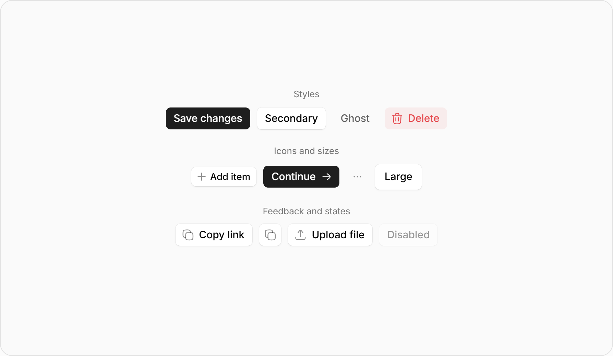
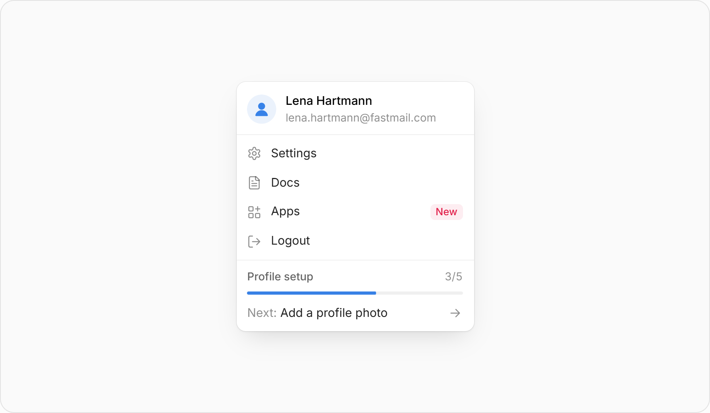
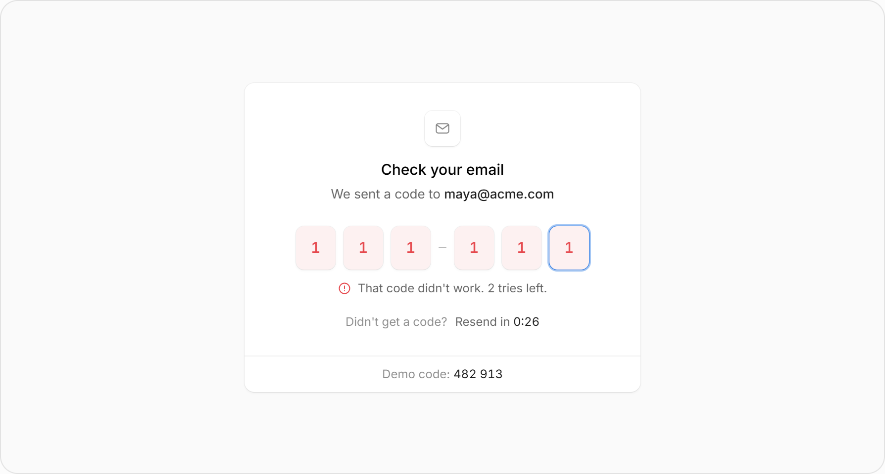
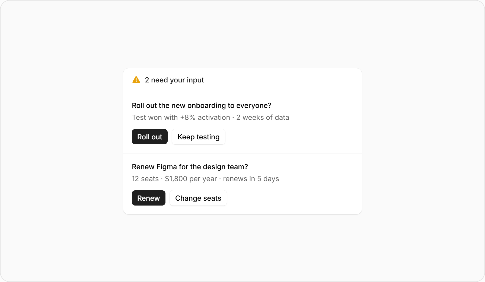
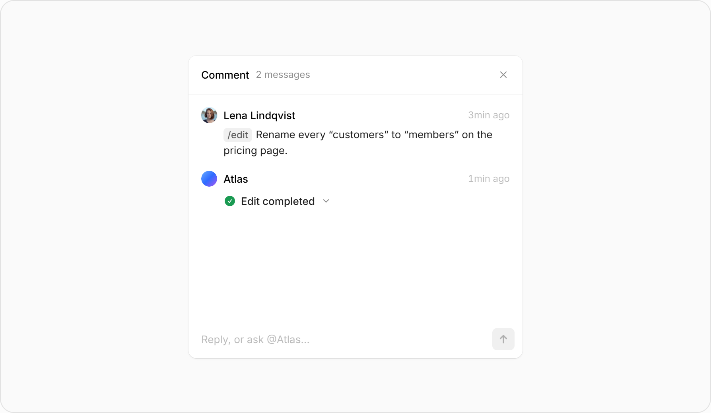

# Affect UI Clean / Light reference contract

Date: 2026-10-23 (Asia/Qyzylorda). Scope: specification and source-reference evidence only.

The catalog below preserves original inspected source measurements as provenance. Those values are not current Dubbed control targets after the 2026-10-25 density correction in design-tokens.md. The owner authorized correcting undersized actions; under delegated authority, the Orchestrator selected the numeric roles, which were not separately human-approved pixel measurements. This document makes no claim about current Dubbed CSS or rendered acceptance.

## Start here

Open these PNGs at full size before choosing presentation; thumbnails orient the eye, while matching Clean CSS supplies exact component values.

Do not copy the showcase outer canvas or large surrounding whitespace as Dubbed page layout. Observe the component or content/action grouping within it; stills do not prove motion, accessibility or rendered product fidelity.

### Direct component references

| BTN: action treatment | PRO: floating surface | OTP: invalid state |
|---|---|---|
| [](../evidence/affect-ui-clean-light/source/components/button/Clean/Light/01-initial.png) | [](../evidence/affect-ui-clean-light/source/components/profile-menu/Clean/Light/01-initial.png) | [](../evidence/affect-ui-clean-light/source/components/otp-input/Clean/Light/03-invalid-code.png) |
| Observe dark primary versus white secondary actions, quiet layered edges and clear disabled treatment. | Observe stronger floating depth, grouped identity/actions and restrained separators without adopting sample profile content. | Observe invalid cell tint, edge/focus distinction and associated feedback without adopting demo code or attempt policy. |

Read the corresponding [BTN](../evidence/affect-ui-clean-light/source/components/button/Clean/button-clean.md.txt), [PRO](../evidence/affect-ui-clean-light/source/components/profile-menu/Clean/profile-menu-clean.md.txt) and [OTP](../evidence/affect-ui-clean-light/source/components/otp-input/Clean/otp-input-clean.md.txt) Clean source for the exact recipe.

### Composition references only

These three images are inspiration for context, action grouping and long-text hierarchy, not newly adopted component families or product features.

| Decision inbox | Email draft | Comment thread |
|---|---|---|
| [](../evidence/affect-ui-clean-light/source/components/decision-inbox/Clean/Light/01-initial.png) | [](../evidence/affect-ui-clean-light/source/components/email-draft/Clean/Light/01-initial.png) | [](../evidence/affect-ui-clean-light/source/components/comment-thread/Clean/Light/01-initial.png) |
| Observe each decision's context and consequence placed next to its distinct actions. | Observe separated context, recipient/detail, long message and final action groups within one coherent surface. | Observe actor/message hierarchy, readable wrapping and a distinct reply area without importing chat behavior. |

Filled source icons and the gradient avatar are not adopted: Dubbed retains its outlined Lucide treatment and current tokens. No exact CSS or motion values are inferred from these three PNGs, and no additional Clean code snapshots are implied.

The approved product goal and low-fi determine content and order; Affect supplies component appearance. Its DNA includes differentiated control/selection/surface shapes, quiet layered versus floating depth, local compact interiors and clear hierarchy—not an empty white page or a universal interior spacing scale.

Use the applicable few examples for the slice, then follow [internal calibration](../frontend-design-workflow.md#internal-component-calibration). A whole-library audit is not required for every task.

## Authority and reading order

The owner selected **Affect UI, Clean variant, Light mode** as Dubbed's visual source and explicitly retained **Mabry Pro**. This is a source-backed adoption contract, not an instruction to import an entire library or reproduce its demonstration product. [Design tokens](design-tokens.md) define the resulting Dubbed semantic roles and accessibility overrides; [shared decisions](00-shared-contract.md) and the active flow specifications continue to own product behavior. Source examples cannot change authentication, billing, recording, generation, navigation or service boundaries.

Only mapped visual treatments and bounded functional motion are adopted. Classic/other variants and Dark mode remain excluded. Source demonstration content, marketing blocks, routes, fetch examples, timers and business rules are never imported automatically. This is not a ban on truthful purpose-led Landing explanation, intended result/value, user effort, clear entry or permitted proof selected through the product/design workflow. Do not invent user results, metrics, testimonials, prices, voice-cloning claims or unsupported promises. Prepare/manual editing/background audition, public sharing and an anonymous viewer remain withdrawn.

The source root inspected is `D:\Program\frontend\affect-ui\affectui-free`. The portable [evidence manifest](../evidence/affect-ui-clean-light/manifest.json) records exact original relative paths, SHA-256 hashes, byte sizes and copied evidence paths. Eight raw Clean Markdown snapshots are stored with `.md.txt` extensions to preserve their bytes as evidence rather than treat their examples/imports as project code. Their Dark sections and external example links remain archival text and have no adoption authority. Seventeen Light PNGs are retained: the original fourteen component-state references and three composition-only references shown above. The eight direct families below remain the adopted component register; broader examples are not automatically approved families. No Dark PNG or other-variant asset was copied.

Source line references below use one-based lines of the original Markdown files; their byte-identical `.md.txt` copies preserve those lines. CSS owns exact values. PNGs establish the supplied appearance of individual states, not CSS-pixel measurements, temporal behavior, mobile suitability, accessibility or Dubbed implementation acceptance. The demo screenshot's outer frame, whitespace, labels and sample content are not component requirements.

## Selected source register

| ID | Original path relative to source root | Portable source | Exact reference sections |
|---|---|---|---|
| BTN | `components/button/Clean/button-clean.md` | [Raw source](../evidence/affect-ui-clean-light/source/components/button/Clean/button-clean.md.txt) | API/a11y 86–115; width morph 188–204; native semantics 214–245; Light tokens/geometry 289–376; states 378–440; motion/reduced motion 455–540 |
| FIL | `components/filter-menu/Clean/filter-menu-clean.md` | [Raw source](../evidence/affect-ui-clean-light/source/components/filter-menu/Clean/filter-menu-clean.md.txt) | Keyboard/a11y 78–96; tokens 422–455; chips 479–516; groups/checks 520–605; responsive/reduced motion 642–660 |
| PRO | `components/profile-menu/Clean/profile-menu-clean.md` | [Raw source](../evidence/affect-ui-clean-light/source/components/profile-menu/Clean/profile-menu-clean.md.txt) | Keyboard/a11y 72–87; tokens 312–340; card/user 346–386; rows 389–418; source-only setup 438–502; touch/reduced motion 504–510 |
| SEG | `components/segmented-control/Clean/segmented-control-clean.md` | [Raw source](../evidence/affect-ui-clean-light/source/components/segmented-control/Clean/segmented-control-clean.md.txt) | API 107–120; keyboard/pointer implementation 376–451; tokens/sizes 532–569; option/indicator 610–710; touch/reduced motion 717–725 |
| PGR | `components/progress-tracker/Clean/progress-tracker-clean.md` | [Raw source](../evidence/affect-ui-clean-light/source/components/progress-tracker/Clean/progress-tracker-clean.md.txt) | Demo/checkbox API 68–104; tokens/card 270–300; title/bar 320–377; excluded entrances 387–394; row/check 396–451; reduced motion 533–541 |
| NOT | `components/notification-stack/Clean/notification-stack-clean.md` | [Raw source](../evidence/affect-ui-clean-light/source/components/notification-stack/Clean/notification-stack-clean.md.txt) | API/a11y 70–90; tokens 311–340; card/exit 348–370; source-only ornament 373–410; content/actions 412–458; touch/reduced motion 461–474 |
| OTP | `components/otp-input/Clean/otp-input-clean.md` | [Raw source](../evidence/affect-ui-clean-light/source/components/otp-input/Clean/otp-input-clean.md.txt) | Conflicting example/API 80–119; real input 520–550; tokens/cells 596–665; ring 673–689; states 715–795; resend/reduced motion 797–853 |
| THK | `components/thinking-loader/Clean/thinking-loader-clean.md` | [Raw source](../evidence/affect-ui-clean-light/source/components/thinking-loader/Clean/thinking-loader-clean.md.txt) | Controlled-phase API/a11y 84–101; tokens/sizes 285–322; spinner/check 331–376; label/shimmer 379–415; reduced motion 439–449 |

## Exact Light color and surface vocabulary

These are **source values**, before the explicit Dubbed accessibility adaptations below. Preserve alpha values rather than silently substituting approximate solid grays; their result depends on the actual backing surface.

| Source role | Exact value | Evidence |
|---|---|---|
| Card/secondary control | `#ffffff` | BTN 297; PRO 313; FIL 423 |
| Strong heading/title | `#000000` | BTN 290; PRO 314; FIL 425 |
| Main ink / dark primary fill | `rgba(0, 0, 0, 0.88)` | BTN 291,294 |
| Dark primary hover | `rgba(0, 0, 0, 0.8)` | BTN 295 |
| On dark primary | `#fcfcfc` | BTN 296; this is not evidence of a global page-ground declaration |
| Secondary text / ghost resting label | `rgba(0, 0, 0, 0.61)` | BTN 292; PRO 316; FIL 426 |
| Muted / faint source metadata | `rgba(0, 0, 0, 0.45)` / `rgba(0, 0, 0, 0.27)` | PRO 317–318; FIL 427–428 |
| Quiet icon | `rgba(0, 0, 0, 0.447)` | BTN 293; PRO 319; FIL 429 |
| Decorative line / fill / progress track | `rgba(0, 0, 0, 0.06)` | PRO 320,323; FIL 430–431; PGR 278 |
| Hover wash | `rgba(0, 0, 0, 0.03)` | BTN 300; PRO 321; FIL 433 |
| Stronger source fill | `rgba(0, 0, 0, 0.1)` | FIL 432 |
| Segmented tray | `rgba(0, 0, 0, 0.04)` | SEG 539 |
| Selected / working accent | `rgba(0, 96, 226, 0.765)` | FIL 435; SEG 542; PGR 280; THK 288 |
| Selected accent wash | `rgba(0, 96, 226, 0.08)` | SEG 543 |
| Source focus halo | `rgba(0, 96, 226, 0.35)` | BTN 306; FIL 437; OTP 611 |
| Destructive label | `#e5484d` | BTN 301; OTP 612 |
| Destructive backing / hover | `rgba(229, 72, 77, 0.08)` / `rgba(229, 72, 77, 0.12)` | BTN 302–303 |
| OTP success / backing | `#1a9a52` / `rgba(26, 154, 82, 0.08)` | OTP 613,615 |

The source defines component variables, not a universal app palette or a complete 50–950 scale. Do not invent a source scale. Dubbed semantic aliases may reuse these exact values while documenting retained product-specific media/recording roles and necessary contrast overrides. The opaque black media stage remains product-owned.

Source shadow families are literal multilayer values:

```css
/* Small control/card edge: BTN 298; FIL 439; SEG 541; PGR 285; NOT 325; THK 290 */
0 0 0 0.5px rgba(0, 0, 0, 0.06),
0 1px 1px -1px rgba(0, 0, 0, 0.1),
0 1px 2px 0 rgba(0, 0, 0, 0.05)

/* Hover edge: BTN 299; NOT 326 */
0 0 0 0.5px rgba(0, 0, 0, 0.1),
0 1px 1px -1px rgba(0, 0, 0, 0.12),
0 1px 3px 0 rgba(0, 0, 0, 0.07)

/* Floating profile menu: PRO 329 */
0 0 0 0.5px rgba(0, 0, 0, 0.08),
0 12px 28px -10px rgba(0, 0, 0, 0.16),
0 1px 2px 0 rgba(0, 0, 0, 0.05)
```

Use small shadows for mapped controls/cards and the floating family for an actual floating surface. This does not authorize extra cards, nested wrappers or shadows under every page region. Decorative hairlines are not sufficient essential input boundaries.

## Exact geometry and typography inventory

Source typography is Inter/InterVariable, regular400 and medium500 in the selected components. Dubbed substitutes Mabry Pro Regular/Medium by explicit owner instruction; no synthetic bold or Inter installation follows from adoption. Dubbed body/dialogue16/24, readable supporting captions14/20 and established page headings remain product typography roles. The24/28/32px source button heights and12/16 small,13/20 medium/large source labels remain original source values in this catalog only. Current Dubbed desktop/phone action sizes follow the owner-approved role contract in design-tokens.md; source measurements are not current product targets.

| Component | Exact source geometry / typography | Dubbed adoption boundary |
|---|---|---|
| Button, sm | Height24, horizontal padding8, gap4, icon14, radius6; Medium12/16 | Compact source option; never infer a phone tap target from its visible box |
| Button, md | Height28, horizontal padding10, gap6, icon16, radius6; Medium13/20 | Default source compact control; icon side padding is reduced by2 (BTN 348–376) |
| Button, lg | Height32, horizontal padding12, gap6, icon16, radius6; Medium13/20 | Larger source compact control; icon-only button is square, width equals height |
| Profile menu | Max width260; card padding4/radius10; account row gap10/padding8 12 10; avatar32; item height32/padding0 8/gap10/radius6; base13/20, email12/16 | Preserve only existing Dubbed account actions and identity; no source Docs/Apps/New badge/profile-completion upsell |
| Filter menu | Max width400/radius10; header padding12 10 8 16/gap12; title Medium15/24; group/option32high/radius6; option left inset32; checkbox14/radius4; chips24high/radius6/gap2; chip row gap4 | Visual vocabulary only where the flow already defines filters/multiselection; it does not add new filter groups |
| Segmented control | Outer radius8; option/indicator radius6; md28high/padding0 10/text13/20/icon16/gap8; sm24/12/16/icon14; lg32/padding0 12 | Source has buttons, tray and underline treatments. Choose per existing radio vs tabs meaning, never add billing periods or view modes from examples |
| Tray / underline variants | Tray background black.04, padding2, white raised pill; underline gap20, text inset2, indicator1.5high/radius1.5, option height source size+6 | Reuse the appropriate existing control pattern; no decorative tab set |
| Progress tracker | Max width340; card radius10/padding14 6 6; title15/24; metadata12/16; bar4high/radius2/margin10 10 8; row gap10/padding6 10/radius6; status circle16/check12 | Visual adaptation for real processing status; source editable checklist semantics and user-toggle completion do not describe a backend job |
| Notification | Max width380; card radius10; body padding12 12 16 16; heading15/24; text13/20; action28high/radius6/gap6/padding0 10; close28square/radius6 | Source treatment for an already-required notice/toast only; no announcement feed, invitation, decorative art or source uppercase badge |
| OTP | Preferred cell width40, height1.1×width =44, radius.2×width =8, gap8; type min(15px,.375×cell)/24 Medium; live real input16px | Adapt to Dubbed code entry and existing input semantics. Narrow-container shrinking is a source mechanism, not permission to make unreadable digits or phone targets |
| Thinking loader | md32high/radius8/gap6/padding0 10 0 8/type13/20/icon16; sm26/radius6/gap5/padding0 8 0 6/type12/16/icon14 | One working-status primitive; no chat bubble or invented AI phase text. Plain variant removes height/padding/backing/shadow |

Local spacing is intentionally not one global scale: 2/4/6px organize compact internals, 8/10/12/14/16px organize rows and cards. Existing page gutters, content widths and responsive layout remain Dubbed-owned; the source component max widths are not page widths. Do not derive a global layout from PNG canvas dimensions.

Source touch adaptations are component-specific: PRO rows40/next36; FIL groups/options44, Clear36, chips32 and chip-close26; SEG options40, lg/tray44; NOT action/close36; PGR row vertical padding10; OTP resend padding7 12. These do not prove Dubbed's retained **48px phone interaction target** contract. Keep the selected Clean visible treatment while providing sufficient target geometry, separation and readable text; verify clipping/focus/scrolling on actual phones.

## Functional motion: source facts and adoption limits

The source's shared ease is `cubic-bezier(0.22, 1, 0.36, 1)`. Segmented movement uses `cubic-bezier(0.25, 0.9, 0.3, 1)`; button content/width morph uses `cubic-bezier(0.25, 1, 0.5, 1)`. These are different curves, not a single global spring. FIL declares `cubic-bezier(0.34, 1.56, 0.64, 1)` but a declaration alone does not authorize bounce in Dubbed.

| Interaction | Exact source timing / behavior | Bounded Dubbed treatment |
|---|---|---|
| Button hover/press | Color/background/shadow/opacity140ms ease; transform160ms shared ease; press scale.97 (BTN 340–345,428–429) | Adopt as reversible local action feedback; a disabled/loading action cannot run |
| Button label/icon change | Width480ms and label480ms, icon520ms with button morph ease; source label blur3 + y25%, icon blur2 + scale.7 (BTN 188–204,455–510) | Width/content replacement can settle locally; omit decorative blur. Never wait for it before recording, save acknowledgement, payment state or navigation |
| Working button | Spinner900ms linear infinite; source text sweep650×1.6 =1040ms (BTN 308,490–495) | Functional spinner only while real work is pending; preserve readable label. Gradient sweep is excluded |
| Menu hover | PRO140ms out/60ms in; FIL140ms out/90ms in (PRO 400–402; FIL 530–532,576–578) | Adopt local wash/ink feedback, including reverse transition; focus remains independently visible |
| Segmented selection | Indicator edges200ms; leading/trailing220/160ms by direction; press120ms/scale.97; option colors90ms; width200ms (SEG 624–626,684–689) | Adopt local selected-indicator movement only for an existing choice, with product locks honored for keyboard, pointer and touch |
| Filter expansion/check | Group height320ms; chevron260ms; panel opacity220ms; chip260ms; selected check240ms +40ms delay; checkbox fill160ms (FIL 482,500,543,553,562,590,602–605) | Eligible only for existing filter content; no route-entry or automatic sequence. Selection state changes immediately |
| Status label/check | THK width/in460ms, outgoing320ms; icon opacity240ms/transform420ms; check draw360ms +120ms; ray cycle800ms (THK 344–415) | Real service event owns text and completion. Optional local change/crossfade and functional pending indicator; omit text blur and shimmer; no timer-driven phase invention |
| Notice dismissal | NOT pending card movement460ms; outgoing transform320ms/opacity240ms (NOT 340,359–370) | Eligible only for an already-required dismissible notice; do not put critical errors, quote consent or result availability exclusively in an obscured stack |
| Progress | PGR fill1100ms, check pop560ms, tick420ms +160ms; entry520ms/rows640ms; one-shot shine1400ms (PGR 350,369–394,447–451) | Adopt source bar/row geometry and state marks; keep backend progress honest. Exclude entrance cascade, autoplay/reset, decorative shine and user-editable completion. A smoothing animation never predicts progress |
| OTP | Cell colors220ms; ring motion260ms; source success cells340ms, frame width460ms +220ms, check380ms +560ms; error/label folding300ms (OTP 665,685,767–791) | Keep field value and service outcome authoritative. No shake, text blur, shimmer or delayed navigation. A bounded visual acknowledgement cannot create a successful verification |

No page-entry cascade, parallax, marketing loop, grid-background drift, number-ticker spectacle, dedicated shimmer-loader or text-reveal is adopted. No background gradient or animated recording decoration is introduced. Flat tint fills and shadows above remain supported. Source loading uses gradient masks; those are explicitly omitted under this bounded adoption, while functional pending spinners remain eligible outside reduced motion.

With reduced motion, local transitions and nonessential looping spinners stop; use a static pending mark plus readable status. The source is not copied blindly: BTN 528–540 stops label/icon/sweep effects but does not disable its 900ms spinner rule, so Dubbed needs a stronger reduced-motion override. Media playback and synchronized audio/playhead motion remain functional under the product contract. Animation completion never gates an operation, acknowledgement or navigation.

## Semantic, keyboard and service adaptation

The intended **shadcn primitives remain the semantic foundation**. Apply these exact selected source visuals to Button, Input, InputOTP, Select/Combobox, Checkbox/RadioGroup, Tabs/ToggleGroup, DropdownMenu, Popover, Dialog/AlertDialog, Progress and toast/status primitives as appropriate to their actual job. This table is architecture intent, not a claim about installed packages or a particular shadcn API/version. No additional Affect UI runtime package, React upgrade or dependency installation is implied.

- BTN uses a native button and loading `aria-busy`/`aria-disabled`, keeps focus, and blocks its onClick; Dubbed must also prevent duplicate submit/shortcut paths and retain labels. Icon-only actions need accessible names. Links remain links for navigation.
- FIL uses expandable button headers, checkbox options, a roving tab stop and politely announced removable chips. Preserve only behavior actually required by an existing multi-choice filter; a single choice should remain a select/radio control.
- PRO uses menu semantics, arrow/Home/End navigation and native actions. Dubbed's menu must retain trigger/open/close/Escape/focus-return behavior from the chosen accessible primitive; a standalone source account card does not establish all popover behavior. Source PRO 403 removes outline and uses hover wash for row focus; use the explicit stronger Dubbed focus treatment.
- SEG's source defaults to a radio group but also supports tablist/panel relationships. Choose semantics from what changes, not its appearance. Source drag calls `onChange` while crossing options (SEG 415–449); dragging cannot bypass capture, playback, async or navigation locks. Gesture support is not required merely because the source includes it.
- PGR is an editable checkbox checklist with optional autoplay/reset. Backend processing stages instead need non-editable status/list semantics, honest known progress, accessible status updates and approved cancellation/retry rules. Never copy `autoPlay`, timer completion or click-to-complete into a job.
- OTP uses one real input with numeric keyboard, `autocomplete="one-time-code"`, paste and invalid/message relationships (OTP 520–550). Its default `clearOnError=true`, resend30, direct fetch example, auto-complete callback and success navigation are **not** Dubbed policy. Preserve the entered code on failure (`clearOnError=false` if reusing that option), existing 60-second/service-owned resend contract, explicit verification submission/trigger rules and centralized facade. Retry counters and success require actual service state.
- THK exposes status/live polite once while hiding duplicate animated copies. Use controlled service phases; never its default interval2200 or invented searching/reading phases. NOT's source only exposes its front card to focus/reading; Dubbed essential status/recovery cannot disappear behind another notice.

### Explicit adaptations with no direct source counterpart

The supplied catalog has no direct generic form input, password field, modal/dialog, upload dropzone/file picker, source-section timeline, waveform, recording meter, media player or payment form counterpart. Do not cite a fictional Affect component for them. Adapt the selected Clean tokens/radius6 controls/radius10 floating surfaces/quiet rows onto the intended shadcn or native/media primitive, while preserving the full product contract. Dialog dimensions, field height, upload state, millisecond precision, capture timing, media controls, destructive confirmation and financial consent remain flow-owned requirements.

Result version selection is not an AI-message regenerate action. Recording acceptance is not a social reaction. A quote is not a smart recommendation. Download is not public sharing. The reference does not add any of those source product features.

## Mapping across all twelve active flows

| Active flow | Mapped source treatment | Explicit product boundary / necessary adaptation |
|---|---|---|
| [01 Landing](01-landing.md) | BTN dark primary, secondary/ghost, Clean ink/hairline/spacing vocabulary | Explain truthful product purpose/result/value, user effort and next step; permitted proof and content hierarchy follow the approved product/design target, with no automatic import of source marketing content or fabricated claims |
| [02 Sign-in](02-sign-in.md) | BTN primary/secondary/ghost; PRO-style compact method rows where already defined | Labelled email/password/native fields are adaptations; retain session return and accessible form semantics |
| [03 Registration](03-registration.md) | BTN and OTP cells, tint-invalid/verified status treatment | Preserve entered code, existing resend/expiry/service rules and success destination; no sample demo code/footer |
| [04 Password reset](04-password-reset.md) | BTN, OTP visual vocabulary where a code is already required; readable status | Password fields/dialogs are adaptations; keep explicit reset state and approved default return route |
| [05 Linking](05-account-linking.md) | BTN, PRO quiet method/action rows; OTP only where actual contract uses it | No silent provider linking; reauthentication and confirmation remain exact product requirements |
| [06 New dub](06-new-dub.md) | BTN upload/quote actions, SEG if an approved existing finite choice needs it, FIL row/check vocabulary for actual choices | File picker/dropzone and section timeline are explicit adaptations. Keep 0.001-second precision, 1–120-second inclusive section and explicit quote consent; no Prepare screen |
| [07 Processing](07-processing.md) | PGR stage/bar/check appearance, THK controlled status, BTN cancel/retry | No source checklist toggles/autoplay/fake progress; backend cancellation/cost/race/reprocessing rules remain authoritative |
| [09 Record](09-record.md) | BTN Replay / Record / Your take, grouped separately from navigation; quiet actionable status | Contextual performance panel is an owner-directed prototype target, with phone/short-screen geometry pending. Waveform/player/mic/capture are derivatives; retain one synchronized audition source, candidate preference and replay reset. During capture, original reference video/audio follow the fixed window with automatic stop; Replay / Your take audition, seeking and source-switch controls are disabled while reference volume remains adjustable. Microphone-test Stop remains distinct |
| [10 Result](10-result.md) | BTN Play/Watch new/Download; THK assembly status; unobtrusive notice treatment | Preserve playing previous generation, paused Watch new at start, no autoplay and displayed-generation download; no message rating/regenerate/share behavior |
| [11 Projects](11-projects.md) | BTN, PRO/FIL quiet rows and existing action/filter controls, source floating shadow for actual menus | Project list/card shape is adapted; no new board/calendar/filter dimensions. Preserve resume, automatic drafts, capacity and deletion safeguards |
| [12 Credits](12-credits.md) | BTN pack/purchase actions, quiet source row/card hierarchy and inline status | Purchase/payment/history components are adaptations; no subscription period, discount badge, invented price or timed number animation; finance/provider decisions stay open |
| [15 Account](15-account.md) | PRO account/method/action hierarchy, BTN including destructive tint, Clean floating surface | No source profile-completion steps, upsells, fake avatar requirement or extra Docs/Apps destinations; preserve linking/deletion/reauthentication rules |

## Catalog exclusions

The original Markdown descriptions of `change-summary`, `comment-thread`, `decision-inbox`, `email-draft`, `message-actions`, `reaction-bar`, `smart-recommendation`, `tips-panel` and `tool-call-card` were inspected for fit. Their whole feature behaviors are excluded: metric trend recaps, chat/replies, approval inboxes, outbound email, AI rating/version actions, social reactions/reposts/sharing, confidence/recommendation acceptance, onboarding tips and developer tool-call/JSON inspection are outside the twelve-flow MVP. A generic shared row/button visual may use selected tokens without importing these features. Decision-inbox, email-draft and comment-thread PNGs above are composition-only references; partial form/action examples do not establish a complete generic Input/Dialog or accessibility implementation. No exact color/CSS/motion contract is inferred for these extra families.

`blocks/logo-marquee`, `blocks/testimonial-wall`, `motion/grid-background`, `motion/number-ticker`, `motion/shimmer-loader` and `motion/text-reveal` are excluded by role; none is required to reproduce the selected app-control vocabulary. No illustrations were adopted. Exclusion is not a statement that those components are defective.

## Accessibility overrides and static evidence

The source's weak metadata/focus values are not accepted as proof of accessibility. [Design tokens](design-tokens.md) own final role assignments. Required readable metadata uses the source's stronger black.61 text role rather than black.45/.27. Source thin decorative lines and shadows remain decorative; essential fields need a visible boundary with verified contrast, plus labels and state semantics. A candidate source-derived boundary is black.447. Focus uses opaque source hue `#0060e2`, 2px ring and a 2px light gap; the original 35% halo can only be additional decoration. The exact compositing background must be controlled, including media focus on an opaque backing.

Computed on 2026-10-23 with Python3.13 in this Windows workspace: alpha-over-opaque compositing, each channel rounded to nearest 8-bit value, then standard sRGB linearization and relative-luminance contrast. These are a bounded static candidate check, not a full palette audit or browser WCAG claim.

| Candidate | On white: composed color / ratio | On `#fcfcfc`: composed color / ratio | On `#f5f5f5`: composed color / ratio |
|---|---|---|---|
| black.61 readable secondary | `#636363` /6.008 | `#626262` /5.945 | `#606060` /5.768 |
| black.45 source muted | `#8c8c8c` /3.363 | `#8b8b8b` /3.321 | `#878787` /3.295 |
| black.447 essential-boundary candidate | `#8d8d8d` /3.319 | `#8b8b8b` /3.321 | `#878787` /3.295 |
| source blue.765 | `#3c85e9` /3.669 | `#3b85e8` /3.587 | `#3a83e6` /3.459 |
| source focus blue.35 | `#a6c7f5` /1.734 | `#a4c5f3` /1.726 | `#9fc1ee` /1.699 |
| opaque source hue `#0060e2` | 5.568 | 5.427 | 5.107 |
| source red `#e5484d` | 3.914 | 3.815 | 3.590 |
| darker-red candidate `#d12e34` | 5.058 | 4.931 | 4.640 |

Black.45/.27 are not normal readable small-text roles; source blue.765 and source red fail a 4.5:1 normal-text target on these grounds. Their stronger opaque/readable aliases must be explicit adaptations, rather than a false claim of literal source fidelity.

The first darker-red candidate `#d12e34` is **rejected** for normal destructive text on the actual source tint family: its contrast over8%/12% source-red tint is4.555/4.332 on white,4.463/4.216 on `#fcfcfc`, and4.201/3.989 on `#f5f5f5`. The recommended explicit readable-label adaptation is **`#c1262c`**; preserve source `#e5484d` as the tint/accent primitive. With the same8-bit compositing method, the stronger label yields:

| Opaque backing | Composed8% tint / label ratio | Composed12% hover tint / label ratio |
|---|---|---|
| `#ffffff` | `#fdf0f1` /5.281 | `#fce9ea` /5.022 |
| `#fcfcfc` | `#faeeee` /5.174 | `#f9e6e7` /4.887 |
| `#f5f5f5` | `#f4e7e8` /4.871 | `#f3e0e1` /4.624 |

This is a named contrast adaptation, not a color found in the source. Final role assignment belongs in design-tokens.md and must agree with the shared adoption decision. Disabled source opacity.4 (BTN) or.55 (OTP) is not a normal text role; preserve disabled semantics and a separately legible product treatment. Disabled-control exemptions do not justify dimmed pending text, essential help or entire forms.

Required runtime verification remains: actual Mabry files/weights and fallback; text/zoom/reflow at desktop/phone widths; pointer/touch targets; all keyboard/open/close/focus-return paths; actual focus geometry and forced colors; non-color error/selected/loading communication; reduced motion including every pending indicator; high-contrast essential boundaries; media backing; duplicate-action prevention; service-state accuracy and no animation-gated recording/payment/navigation. PNG inspection and static ratios establish none of these runtime outcomes.

## Evidence receipt and implementation gate

The [portable reference inventory](../evidence/affect-ui-clean-light/README.md) enumerates states, reference-only scope and reproducibility limits. No frontend code, package installation, service call, browser execution of these components, commit, push or deployment was performed for this analysis. The preserved source is a provenance artifact; future implementation must use the resulting shared token/flow contract and verify actual rendered Dubbed controls.
